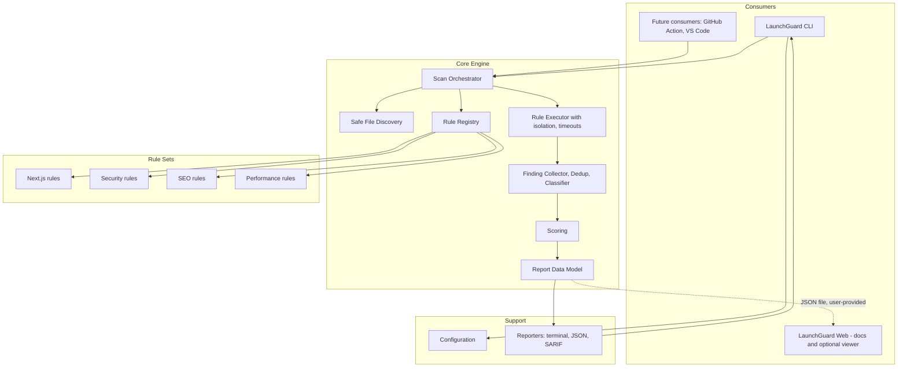
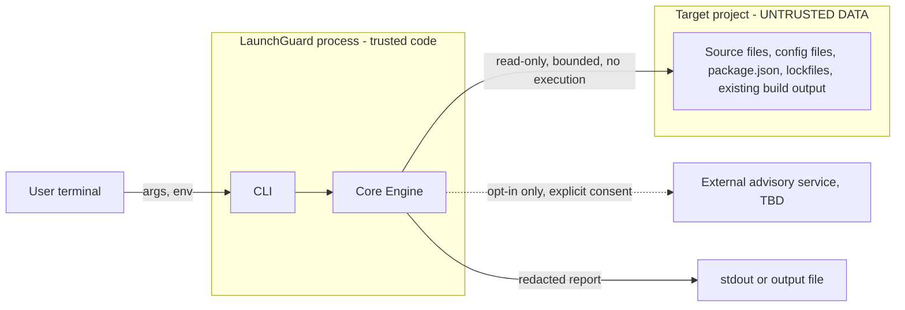
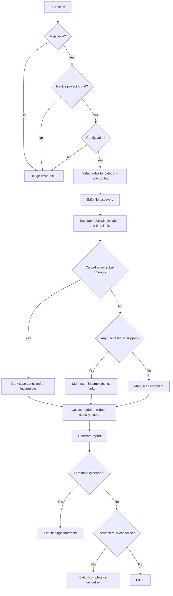
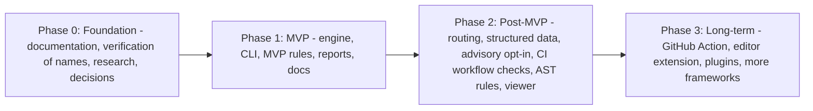
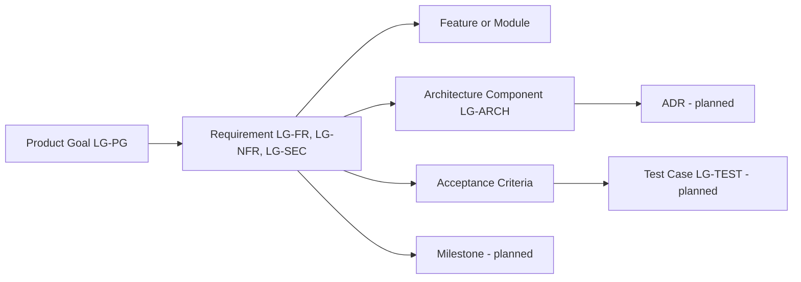

# LaunchGuard — Project Charter & Product Requirements Document

---

# 1. Document Control

## 1.1 Document Metadata

| Field | Value |
|---|---|
| Document ID | DOC-001 |
| Title | LaunchGuard — Project Charter & Product Requirements Document |
| File name | `DOC-001-LAUNCGUARD-PROJECT-CHARTER-AND-PRD.md` (as specified in the commissioning brief; see OQ-032 regarding the spelling) |
| Version | 1.0.0 |
| Status | **Draft — Pending Review** |
| Date | 2026-11-17 |
| Author | AI-assisted drafting on behalf of the project owner (human author of record: TBD) |
| Reviewers | TBD |
| Approver | TBD (project owner) |
| Supersedes | None |
| Next planned document | See Section 33.3 and OQ-033 (not to be started until this document is approved) |

## 1.2 Status Legend

Every significant statement in this document carries or implies one of the following statuses. Nothing is "Approved" until Section 33 is completed by a human approver.

| Tag | Meaning |
|---|---|
| **DIRECTIVE** | Stated by the project owner in the commissioning brief. Treated as a binding input, but still subject to review. |
| **PROPOSED** | A recommendation made in this document. Not a decision. |
| **TBD** | Unresolved. Must be decided or researched before it can be relied upon. |
| **ASSUMPTION** | Believed true but not verified. Registered in Section 28. |
| **FACT** | An externally verifiable statement. Where it has not been re-verified during drafting, it is marked "verify". |
| **RESEARCH** | A claim that requires external research before use. No claim tagged RESEARCH may be treated as true. |

## 1.3 Change History

| Version | Date | Author | Summary of changes |
|---|---|---|---|
| 1.0.0 | 2026-11-17 | AI-assisted draft | Initial draft for review. |

Proposed document versioning: Semantic Versioning applied to documents (MAJOR for scope-changing revisions, MINOR for added requirements, PATCH for corrections). **PROPOSED**.

## 1.4 Identifier Scheme

| Prefix | Meaning | Defined in |
|---|---|---|
| `LG-PG-nnn` | Product goal | Section 8 |
| `LG-FR-nnn` | Functional requirement | Section 15 |
| `LG-NFR-nnn` | Non-functional requirement | Section 16 |
| `LG-US-nnn` | User story | Section 17 |
| `LG-SEC-nnn` | Security and privacy requirement for LaunchGuard itself | Section 21 |
| `LG-SEO-nnn` | SEO-domain requirement (reserved for future domain documents; none are defined in this document) | Section 14 |
| `LG-<MOD>-Rnnn` | Audit **rule candidate** within a module (`SEO`, `SEC`, `COD`, `PRF`, `DEP`, `RTE`, `DPL`, `SDT`) | Section 14 |
| `LG-ARCH-<name>` | Proposed architecture component label | Section 13 |
| `LG-TEST` | Test case identifiers. **None exist yet.** They will be allocated in a future test strategy document. | Section 31 |
| `ADR-nnn` | Architecture Decision Record. **None exist yet.** Candidate topics are listed in Section 13.6. | Section 13 |
| `LG-QR-nnn` | Additional quality requirement | Section 26 |
| `UI-nnn` | UI and documentation-site requirement | Section 23 |
| `H-nn`, `P-nn`, `C-nn`, `REF-nn` | Problem hypothesis, product principle, contradiction/tension, reference | Sections 5, 11, 28.3, 35 |
| `LG-RISK-nnn` | Risk | Section 29 |
| `LG-ASM-nnn` | Assumption | Section 28 |
| `LG-CON-nnn` | Constraint | Section 28 |
| `OQ-nnn` | Open question | Section 32 |

Note on ambiguity: `LG-SEC-nnn` denotes requirements on LaunchGuard's own behaviour. Rule candidates for the *Security Audit module* use `LG-SEC-Rnnn` to avoid collision. The runtime `ruleId` placed in findings is a separate identifier whose format is TBD (OQ-014).

---

# 2. Executive Summary

LaunchGuard is a proposed open-source, local-first command-line tool that statically inspects a Next.js project and reports production-readiness problems before deployment. Findings span technical SEO, security configuration, code quality, performance indicators, dependencies, routing, deployment readiness and structured data. Every finding is intended to state what is wrong, where, why it matters, how severe it is and how to fix it.

The product comprises three proposed layers: a **CLI**, a reusable **Core Engine** that is independent of any user interface, and an optional **Web** experience (documentation and a client-side report viewer). A local scan must never depend on the web application.

This document is the first authoritative specification. It defines scope, requirements, security and privacy expectations, quality metrics, risks, traceability and unresolved questions. It deliberately separates **directives** from **proposals**, and it records contradictions in the brief rather than silently resolving them (Section 28.3).

Key points for reviewers:

- The MVP is intentionally narrower than the full vision (Section 25). Several modules (routing, structured data, advisory lookup, GitHub Actions checks, build-output analysis) are classified **post-MVP** because they require capabilities (AST analysis, network consent design, executing or parsing build output) that are not yet decided.
- LaunchGuard will analyse **untrusted repositories**. This makes "never execute target-project code" a foundational requirement and has direct consequences, for example static-only analysis of `next.config.*` and data-only configuration files.
- The readiness score is an **informational heuristic**, never a security certification.
- No source code, repository, package, benchmark, user research or market data exists or is claimed in this document.
- Name, npm scope, repository, domain, license, supported versions and hosting are **unverified or undecided**.

---

# 3. Project Introduction

## 3.1 Purpose of This Document

To establish a single reference for the project's intent, boundaries and requirements, from which architecture, design, implementation, testing, security, deployment and community documentation will be derived.

## 3.2 Project Summary

| Attribute | Value | Status |
|---|---|---|
| Project name | LaunchGuard | PROPOSED (provisional; unverified) |
| Tagline | "Know what's wrong before you deploy." | PROPOSED (see contradiction C-01) |
| Category | Open-source developer tooling; Next.js production-readiness auditing | DIRECTIVE |
| Primary technology | Next.js, TypeScript, Node.js | DIRECTIVE |
| Primary product | Local-first CLI over a reusable scanning engine | DIRECTIVE |
| Supporting product | Next.js web app for docs and optional report viewing | DIRECTIVE |
| Development approach | Documentation-first, open-source, community-oriented | DIRECTIVE |

## 3.3 Document Scope

In scope: product-level requirements and constraints. Out of scope: source code, repository scaffolding, detailed design, algorithms, test cases, CI definitions. These will be produced by later documents after approval.

## 3.4 Intended Audience

Project owner, prospective maintainers and contributors, security reviewers, and any engineer or tool (including AI-assisted tools) producing subsequent documents.

---

# 4. Product Vision

**Vision (PROPOSED):** Give every Next.js developer a trustworthy, explainable, offline-capable way to find production-readiness problems before they ship, and make the tool extensible enough that the community can grow its rule coverage.

**Vision principles in one line each:** explain every finding; run locally by default; never run the code being audited; be honest about uncertainty; stay useful without any account or service.

**Success looks like (qualitative, PROPOSED):** developers run LaunchGuard in CI and locally because its findings are actionable and mostly correct; contributors can add a rule without understanding the whole engine; maintainers can sustain the project without heavy operational burden.

---

# 5. Problem Statement

The following are **hypotheses**. They have not been validated by user research (RESEARCH).

| ID | Hypothesis | Validation needed |
|---|---|---|
| H-01 | Next.js production-readiness concerns (SEO metadata, headers, environment variables, build configuration) are spread across framework docs, linters, audit tools and manual review, with no single local pass. | Developer interviews and survey; review of existing tooling (Section 7). |
| H-02 | Developers commonly discover metadata, header or configuration omissions after deployment, not before. | Interviews; analysis of public issue trackers and post-mortems (RESEARCH). |
| H-03 | Findings are more likely to be acted on when they include location, rationale and a concrete fix. | Usability testing of report formats. |
| H-04 | Teams want CI-gating on a severity threshold and machine-readable output (SARIF) to integrate with code-scanning dashboards. | Survey of CI practices. |
| H-05 | Developers are reluctant to upload source code to third-party services for audits. | Interviews; the product treats this as a design constraint regardless. |

If H-01 is substantially disproved (for example, existing tooling already covers the proposed surface well), the project's value proposition must be re-examined before implementation (see LG-RISK-011).

---

# 6. Proposed Solution

A local CLI (`launchguard`, distributed as an npm package whose name is TBD) that:

1. Discovers a Next.js project from a directory path.
2. Loads applicable audit rules grouped into modules.
3. Executes rules by **static inspection only**, with no execution of project scripts, no build, no dev server in the MVP.
4. Collects findings in a uniform structure, classifies severity and confidence, deduplicates.
5. Emits reports (terminal, JSON, SARIF) and an exit status suitable for CI.

Network access is off by default and requires explicit, documented user consent for any feature that needs it (LG-SEC-010).

Why static analysis first: it is deterministic, fast, safe for untrusted code, and runs without credentials. Its limits (it cannot observe runtime behaviour, hosting-layer headers, or rendered output) are a first-class part of the product's honesty requirement (Section 11, P-04; Section 14.4).

---

# 7. Market and Competitive Context

**No market statistics, competitor feature claims, download counts or adoption figures are asserted in this document.** All entries below are research to-dos.

## 7.1 Candidate Comparators (to be researched)

| Category | Example tools to evaluate | What must be verified | Status |
|---|---|---|---|
| Browser-based performance/quality auditing | Lighthouse and similar | Overlap with LaunchGuard's performance/SEO scope; where static analysis adds value | RESEARCH |
| Linting | ESLint with Next.js-related configs | Which production-readiness checks already exist as lint rules | RESEARCH |
| Dependency vulnerability scanning | `npm audit`, other SCA tools | Output formats, offline capability, privacy behaviour | RESEARCH |
| Secret scanning | Dedicated secret scanners | Detection quality; avoid duplicating mature tools | RESEARCH |
| Static analysis / SAST | General-purpose SAST engines | Next.js-specific coverage | RESEARCH |
| SEO crawlers and auditors | Crawler-based SEO tools | Static-vs-crawl differences; framework-specific metadata handling | RESEARCH |
| Framework built-ins | Next.js build output and warnings | What the framework already warns about | RESEARCH |

## 7.2 Research Method (PROPOSED)

For each comparator: record version, date of review, licence, input type (static vs runtime), outputs, Next.js-specific rules, network behaviour. Store in a dated comparison table. Cite primary sources (official docs, repositories). Do not rely on third-party summaries.

## 7.3 Provisional Positioning (ASSUMPTION, LG-ASM-001)

LaunchGuard's possible differentiation is **consolidation** (one local pass across categories), **Next.js specificity**, **explainable findings** and **safe-by-design handling of untrusted repos**. It does not aim to replace dedicated secret scanners, SCA platforms or browser performance tools; where they exist, integration or deference may be preferable to reimplementation (OQ-016).

---

# 8. Product Goals

| ID | Goal | Status |
|---|---|---|
| LG-PG-001 | Provide actionable pre-deployment findings across the defined audit categories for Next.js projects. | DIRECTIVE |
| LG-PG-002 | Operate local-first and privacy-consciously; no source-code upload by default. | DIRECTIVE |
| LG-PG-003 | Provide a scanning engine reusable independently of any UI. | DIRECTIVE |
| LG-PG-004 | Support CI usage via deterministic exit codes and JSON/SARIF output. | PROPOSED |
| LG-PG-005 | Make every finding and the readiness score transparent and explainable. | DIRECTIVE |
| LG-PG-006 | Be safe to run against untrusted repositories. | PROPOSED |
| LG-PG-007 | Enable community-contributed rules through a clear extension model. | PROPOSED |
| LG-PG-008 | Build a sustainable open-source project (documentation-first, manageable maintenance burden). | DIRECTIVE |
| LG-PG-009 | Be honest about accuracy: minimise false positives and clearly state analysis limits. | PROPOSED |

**Explicit non-goals:** optimising the project for sponsorship or subscription eligibility; replacing browser performance tooling, secret scanners or SCA platforms; certifying security or compliance.

---

# 9. Target Audience

| Segment | Relevance | Status |
|---|---|---|
| Next.js developers (individual and team) | Primary | DIRECTIVE |
| Full-stack developers | Primary | DIRECTIVE |
| Freelancers and agencies | Primary (handover / pre-launch checks) | DIRECTIVE |
| Technical SEO developers | Secondary (SEO module) | DIRECTIVE |
| DevOps engineers | Secondary (CI gating, SARIF) | DIRECTIVE |
| Open-source maintainers | Secondary (project hygiene; potential contributors) | DIRECTIVE |

Out of audience for the MVP: non-technical site owners, non-Next.js projects.

---

# 10. User Personas

All personas are **hypotheses (RESEARCH)** until validated through user research.

| Persona | Problems | Goals | Expected use | Technical knowledge | Main journey |
|---|---|---|---|---|---|
| **P1. Next.js Developer** | Misses metadata/config omissions; scattered tooling | Ship confidently; fix quickly | Local scan before PR/deploy; reads terminal output | High in React/Next.js; moderate in security/SEO | Install → scan → read findings → fix → rescan |
| **P2. Full-Stack Developer** | Owns frontend, API and deployment; limited time for SEO/security detail | Catch cross-cutting mistakes (env exposure, headers) | Scan with `--only security,deployment`; wants clear remediation text | High generalist; variable depth | Scan → focus on High+ → apply fixes |
| **P3. Freelance Developer** | Must demonstrate quality to clients; no dedicated QA | Pre-handover checklist; shareable evidence | JSON/terminal report attached to handover; repeated scans per client project | High practical skill; limited process tooling | Scan client project → fix → export report → deliver |
| **P4. Agency Engineer** | Many projects, inconsistent standards | Consistent baseline across projects | Shared config file; CI integration; compare scans over time | High; process-oriented | Add config to repo template → CI scan → triage |
| **P5. Technical SEO Developer** | Metadata and indexing errors hard to find in code | Verify metadata, robots, sitemap, structured data in source | `--only seo`; reads rationale; may not fix code themselves | High SEO; moderate code | Scan → export findings → pass to developers |
| **P6. DevOps Engineer** | Needs gating and machine-readable output | Fail builds on severity; ingest into code-scanning dashboards | `--format sarif --fail-on high` in CI | High in CI/CD; moderate in Next.js | Add CI step → tune threshold → review alerts |
| **P7. Open-Source Maintainer** | Contributors submit PRs with config regressions | Automated hygiene check for the project | CI scan on PRs; may contribute rules | High | Add to CI → triage → suggest/contribute rules |

---

# 11. Product Principles

| ID | Principle | Implication |
|---|---|---|
| P-01 | **Local-first** | No network by default; no account; no telemetry in the MVP (OQ-020). |
| P-02 | **Never execute the target** | No running project scripts, builds, config code or dev servers in the MVP. |
| P-03 | **Explain everything** | Each finding carries what, where, why, severity, fix. |
| P-04 | **Honest about uncertainty** | Confidence is explicit; analysis limits and unanalysable items are reported, never hidden. |
| P-05 | **No false assurance** | A passing scan is not a guarantee; the score is not a certification. |
| P-06 | **Deterministic** | Same input and same version produce the same findings and ordering. |
| P-07 | **Engine independent of UI** | Core has no dependency on CLI or Web. |
| P-08 | **Extensible by design** | Rules are self-describing units with metadata. |
| P-09 | **Documentation-first** | Behaviour is specified before implementation. |
| P-10 | **Minimal footprint** | Prefer few dependencies; each dependency justified (supply-chain risk). |
| P-11 | **Genuine value over metrics** | No vanity-metric optimisation. |

---

# 12. Product Scope

## 12.1 Vision Scope (long-term)

Comprehensive, extensible production-readiness auditing for Next.js (and possibly other frameworks) with CI integrations, editor integration, a plugin ecosystem and optional report visualisation.

## 12.2 MVP Scope (PROPOSED; detailed in Section 25)

CLI with `scan`, `rules list`, `init`; core engine; static rules for SEO (basic), Security (configuration and secret-like detection), Code Quality, Deployment Readiness (limited), Performance (large static assets), Dependency (offline hygiene); terminal, JSON and SARIF reports; `--fail-on`; redaction; safe traversal; documentation site (basic).

## 12.3 Post-MVP (PROPOSED)

Routing and link audit; structured data audit; opt-in advisory lookup; GitHub Actions workflow checks; AST-based performance rules; build-output analysis (existing output only); baseline/suppression files; autofix for a small set of safe rules; web report viewer; Pages Router depth; monorepo support.

## 12.4 Long-term (PROPOSED)

GitHub Action; VS Code extension; third-party rule plugins; additional framework support; advanced HTML reports; additional CI integrations; optional runtime measurements (explicitly separate from static analysis).

## 12.5 Explicitly Excluded from the Initial MVP (DIRECTIVE unless noted)

- Cloud accounts, subscriptions, billing.
- Centralised storage of users' source code.
- AI-powered automatic code fixing.
- Executing target-project scripts, builds or servers (PROPOSED).
- Runtime browser performance measurement (PROPOSED).
- Telemetry (PROPOSED; OQ-020).
- Security certification or compliance attestation.

---

# 13. Product Architecture Overview

All architecture in this section is **PROPOSED**. No ADR has been approved or written.

## 13.1 Layers

| Layer | Responsibility | Status |
|---|---|---|
| CLI | Argument parsing, project discovery invocation, terminal reporting, report file output, exit status | PROPOSED |
| Core Engine | Scan orchestration, safe file discovery, rule registry, rule execution, finding collection, classification, scoring, report data model | PROPOSED |
| Web | Marketing-free product site, documentation, optional client-side report viewer | PROPOSED |

## 13.2 Proposed Internal Packages

| Logical package | Responsibility | Separately published to npm? |
|---|---|---|
| CLI | See above | TBD (OQ-005) |
| Core engine | See above | TBD |
| Next.js rules | Next.js structure and configuration rules | TBD |
| Security rules | Security audit rules | TBD |
| SEO rules | SEO and structured data rules | TBD |
| Performance rules | Static performance rules | TBD |
| Reporting | Terminal, JSON, SARIF formatters | TBD |
| Configuration | Config schema, loading, validation | TBD |

These are **logical** boundaries. Whether they become separate packages, internal modules of one package, or a monorepo layout is undecided. Publishing each as a separate npm package is **not assumed**; doing so increases versioning and maintenance cost (LG-RISK-010).

## 13.3 Component Diagram (PROPOSED)



## 13.4 Dependency Direction Rules (PROPOSED)

1. Core must not import from CLI or Web.
2. Rule sets depend on the Core's public rule API, not on each other.
3. Reporters consume only the report data model.
4. Web consumes only the published JSON report schema, never the engine at runtime.

## 13.5 Trust Boundaries (PROPOSED)



Everything inside the target project, including its configuration files, is untrusted input and must be treated as data.

## 13.6 Candidate ADR Topics (none authored)

| Planned ADR | Topic | Related open question |
|---|---|---|
| ADR-001 | Repository layout (monorepo or single package) and package publication strategy | OQ-005 |
| ADR-002 | Parsing strategy for TS/JS/JSON/HTML (parser choice, AST vs pattern matching) | OQ-009 |
| ADR-003 | Rule API and extension model | OQ-012 |
| ADR-004 | Configuration format and loading (data-only) | OQ-010 |
| ADR-005 | Report schema and versioning | OQ-013 |
| ADR-006 | Network access, consent and advisory data source | OQ-017 |
| ADR-007 | Runtime isolation (workers or child processes) for timeouts and cancellation | OQ-011 |
| ADR-008 | Supported Node.js, Next.js, OS matrix | OQ-006, OQ-007 |
| ADR-009 | Test strategy and fixture corpus | OQ-015 |

---

# 14. Product Modules

Each module is **PROPOSED**. "MVP" classification is a proposal subject to approval. Rule candidates are indicative: each must be validated against the documentation of supported Next.js versions before specification (OQ-007). Where a rule depends on framework behaviour, that behaviour is tagged "verify".

Common to all modules: static analysis only (MVP); output conforms to the finding structure (Section 20); modules are selectable by category (`--only`, `--skip`).

## 14.1 SEO Audit

| Attribute | Description |
|---|---|
| Purpose | Detect metadata and indexing-configuration omissions or likely mistakes visible in source. |
| Intended users | P1, P2, P3, P5 |
| Functionality | Inspect Next.js metadata conventions (static `metadata` exports, `generateMetadata` presence, `<title>`/`<meta>` in pages), robots and sitemap files or routes, canonical and Open Graph configuration. |
| Expected inputs | Source files under `app/` or `pages/` (including `src/` variants), `public/`, `next.config.*` (static read), route metadata files. |
| Expected outputs | Findings (category `seo`) with file locations and fixes. |
| Importance | High for public-facing sites; irrelevant for authenticated-only apps (configurable). |
| Dependencies | File discovery; parser (ADR-002); route model for Next.js structure. |
| Limitations | Cannot see rendered HTML, runtime-generated metadata, CMS-driven values or hosting-level redirects. Dynamic `generateMetadata` results cannot be evaluated statically. Length heuristics are conventions, not rules. |
| Classification | **MVP (basic rules)**; sitemap validation depth post-MVP |

| Rule candidate | Description | Default severity (PROPOSED) | Class |
|---|---|---|---|
| LG-SEO-R001 | No title metadata found for a page or its layout chain | Medium | MVP |
| LG-SEO-R002 | No meta description found | Medium | MVP |
| LG-SEO-R003 | Title or description length outside heuristic range (thresholds TBD) | Informational | MVP |
| LG-SEO-R004 | No canonical configuration found (verify mechanism per Next.js version) | Low | MVP |
| LG-SEO-R005 | No robots configuration (file or metadata route) found | Low | MVP |
| LG-SEO-R006 | Site-wide `noindex` or disallow-all detected in configuration likely to reach production | High (Medium confidence) | MVP |
| LG-SEO-R007 | No sitemap file or metadata route found | Low | MVP |
| LG-SEO-R008 | Sitemap file present but malformed or referencing invalid URLs | Medium | Post-MVP |
| LG-SEO-R009 | Open Graph metadata missing (title, description or image) | Low | MVP |
| LG-SEO-R010 | Relative metadata URLs used without a configured base URL (verify per version) | Medium | MVP |

## 14.2 Security Audit

| Attribute | Description |
|---|---|
| Purpose | Find configuration and content risks that commonly lead to exposure. |
| Intended users | P1, P2, P4, P6 |
| Functionality | Check env-file protection via ignore rules, detect secret-like values in files that are not env files, detect secret-like names in client-exposed variables, inspect security-header configuration in `next.config.*`, detect source-map exposure settings. |
| Expected inputs | `.gitignore`, `.env*` files (read with redaction), source files, `next.config.*`, `package.json`. |
| Expected outputs | Findings (category `security`) with redacted evidence. |
| Importance | Highest. Also the highest false-positive and responsible-handling burden. |
| Dependencies | File discovery; redaction subsystem (LG-FR-018); parser. |
| Limitations | Cannot determine whether a file is tracked by version control without invoking VCS tooling (not done in MVP). Security headers may be set by hosting, CDN or reverse proxy outside the repository, so absence in `next.config.*` is not proof of absence in production (Low or Medium confidence). Secret detection is heuristic; it is not a replacement for dedicated secret-scanning tools. |
| Classification | **MVP** |

| Rule candidate | Description | Default severity | Class |
|---|---|---|---|
| LG-SEC-R001 | `.env*` files exist but ignore rules do not cover them | High | MVP |
| LG-SEC-R002 | Secret-like value found in a source or configuration file (known token formats = higher confidence; entropy heuristics = lower) | Critical to High, by pattern | MVP |
| LG-SEC-R003 | Public-prefixed environment variable (`NEXT_PUBLIC_*`, which Next.js inlines into client bundles; verify) has a secret-like name or value | High | MVP |
| LG-SEC-R004 | No security-header configuration found in `next.config.*` (CSP, content-type sniffing, referrer policy, framing protection; HSTS only where HTTPS is expected) | Low to Medium (Low confidence) | MVP |
| LG-SEC-R005 | Browser source maps enabled for production in config (verify option name per version) | Medium | MVP |
| LG-SEC-R006 | `X-Powered-By` header not disabled (verify option) | Informational | MVP |
| LG-SEC-R007 | Use of raw HTML injection APIs in components (needs AST) | Medium | Post-MVP |
| LG-SEC-R008 | Overly permissive remote image or redirect configuration | Medium | Post-MVP |

## 14.3 Code Quality Audit

| Attribute | Description |
|---|---|
| Purpose | Detect configuration conditions that weaken correctness safeguards. |
| Intended users | P1, P2, P4, P7 |
| Functionality | Check TypeScript config presence and strictness, lint config presence, build and test scripts, options that suppress build-time errors. |
| Inputs | `tsconfig*.json`, ESLint config files (presence and static JSON-style content only), `package.json`, `next.config.*`. |
| Outputs | Findings (category `code-quality`). |
| Importance | Medium. |
| Dependencies | JSON parsing; static `next.config.*` reading. |
| Limitations | ESLint flat/legacy/JS configs are executable code in many cases; MVP checks **presence**, not effective rule content. Does not run `tsc` or ESLint. |
| Classification | **MVP** |

| Rule candidate | Description | Default severity | Class |
|---|---|---|---|
| LG-COD-R001 | No TypeScript config in a TypeScript project | Low | MVP |
| LG-COD-R002 | `strict` not enabled (including via `extends`, which requires resolution) | Low | MVP |
| LG-COD-R003 | No ESLint configuration found | Low | MVP |
| LG-COD-R004 | No `build` script in `package.json` | Medium | MVP |
| LG-COD-R005 | No `test` script (or placeholder test script) | Informational | MVP |
| LG-COD-R006 | Config suppresses type or lint errors during build (option names and behaviour version-dependent; verify) | Medium | MVP |
| LG-COD-R007 | No Node.js version constraint declared (`engines` or version file) | Informational | MVP |

## 14.4 Performance Audit

**Static analysis versus real measurement.** This module performs *static indicators only*. It does not load pages in a browser, measure Core Web Vitals, or measure real network or rendering performance. Findings must be worded as "potential" indicators and must not claim measured performance. Real browser measurement is a separate, excluded capability (Section 12.5).

| Attribute | Description |
|---|---|
| Purpose | Flag likely performance liabilities visible without running the app. |
| Intended users | P1, P2, P3 |
| Functionality | Large files in `public/`, image handling patterns, missing image dimensions, client-component density heuristics, analysis of **existing** build output if present. |
| Inputs | `public/`, source files, optionally existing `.next` output (never generated by LaunchGuard). |
| Outputs | Findings (category `performance`) labelled as static indicators. |
| Importance | Medium; useful but low confidence for heuristics. |
| Dependencies | File discovery with size metadata; parser for JSX analysis (post-MVP). |
| Limitations | Cannot know real user conditions; build output may be stale or absent; "excessive client JS" is inherently heuristic (Low confidence). |
| Classification | **MVP (large static assets only)**; remainder post-MVP |

| Rule candidate | Description | Default severity | Class |
|---|---|---|---|
| LG-PRF-R001 | Large static asset in `public/` (size threshold TBD) | Low | MVP |
| LG-PRF-R002 | Plain image element used where framework image component is available (AST) | Low | Post-MVP |
| LG-PRF-R003 | Image element missing explicit dimensions (AST) | Low | Post-MVP |
| LG-PRF-R004 | High density of client-component directives (heuristic; thresholds TBD) | Informational | Post-MVP |
| LG-PRF-R005 | Existing build output indicates large route bundles (requires existing output; format stability TBD) | Low | Post-MVP |
| LG-PRF-R006 | Image optimisation disabled in config (verify option) | Low | Post-MVP |

## 14.5 Dependency Audit

| Attribute | Description |
|---|---|
| Purpose | Surface dependency hygiene and, optionally, known vulnerabilities. |
| Intended users | P1, P2, P4, P6, P7 |
| Functionality | Parse `package.json` and supported lockfiles; check hygiene; optionally query an advisory source with consent. |
| Inputs | `package.json`, lockfile(s). Supported lockfile set TBD (OQ-008); an npm lockfile is the proposed first target. |
| Outputs | Findings (category `dependencies`); dependency metadata in the report. |
| Importance | High for security posture; operationally complex. |
| Dependencies | Lockfile parsers; for advisory lookup: network and an advisory data source (ADR-006). |
| Limitations | Advisory lookup discloses dependency names and versions to a third party and so requires consent. Invoking the package manager in the target directory could read project `.npmrc` (registry URLs, tokens) and is therefore **not** proposed for the MVP. Advisory data quality and coverage are outside LaunchGuard's control. Lockfile-versus-manifest consistency checks are non-trivial. |
| Classification | **MVP (offline hygiene)**; advisory integration **post-MVP** |

| Rule candidate | Description | Default severity | Class |
|---|---|---|---|
| LG-DEP-R001 | No lockfile present | Low | MVP |
| LG-DEP-R002 | Multiple conflicting lockfiles present | Low | MVP |
| LG-DEP-R003 | Wildcard or `latest` version ranges for dependencies | Medium | MVP |
| LG-DEP-R004 | Dependency version has a known advisory (requires opt-in network) | By advisory severity | Post-MVP |
| LG-DEP-R005 | Next.js version outside supported or recommended range (requires maintained data source) | Medium | Post-MVP |
| LG-DEP-R006 | Lockfile inconsistent with manifest | Medium | Post-MVP |

## 14.6 Routing and Link Audit

| Attribute | Description |
|---|---|
| Purpose | Detect broken or invalid internal references. |
| Intended users | P1, P2, P3, P5 |
| Functionality | Build a route table from the filesystem routing conventions; compare statically known internal link targets against it; inspect redirect configuration statically. |
| Inputs | Route directories, source files with literal `href` values, `next.config.*` redirects. |
| Outputs | Findings (category `routing`). |
| Importance | Medium-High for user-facing correctness. |
| Dependencies | Parser (ADR-002); route resolver covering dynamic, catch-all, optional catch-all, route groups and parallel/intercepting routes (complex). |
| Limitations | Computed hrefs, dynamic params and CMS-driven links cannot be resolved statically. Redirect behaviour at runtime ("where testable") requires a running server, which conflicts with P-02; deferred. |
| Classification | **Post-MVP** (see contradiction C-05; reasoning: complexity of correct route resolution would risk false positives and scope growth in the MVP) |

| Rule candidate | Description | Default severity | Class |
|---|---|---|---|
| LG-RTE-R001 | Literal internal link does not match any known route | Medium | Post-MVP |
| LG-RTE-R002 | Link references a missing local static asset | Low | Post-MVP |
| LG-RTE-R003 | Redirect configuration contains an obvious loop or invalid entry (static) | Medium | Post-MVP |
| LG-RTE-R004 | No custom not-found handling found | Informational | Post-MVP |

## 14.7 Deployment Readiness

| Attribute | Description |
|---|---|
| Purpose | Identify missing or risky deployment-related configuration. |
| Intended users | P2, P4, P6 |
| Functionality | Environment variable documentation checks, build script checks (shared with code quality), static review of deployment configuration files, GitHub Actions workflow checks. |
| Inputs | `.env.example` or equivalent, `package.json`, `next.config.*`, `.github/workflows/*`, other deployment files (set TBD). |
| Outputs | Findings (category `deployment`). |
| Importance | Medium. |
| Dependencies | YAML parsing (workflows, post-MVP); environment variable reference extraction. |
| Limitations | Deployment platforms differ; most rules must be platform-neutral or clearly platform-labelled. Actual environment values on the platform are unknowable. |
| Classification | **MVP (limited)**; workflow checks **post-MVP** |

| Rule candidate | Description | Default severity | Class |
|---|---|---|---|
| LG-DPL-R001 | No env-variable template or documentation file found while env variables are referenced | Low | MVP |
| LG-DPL-R002 | Env variables referenced in code but absent from template (pattern-based extraction; confidence Medium) | Low | MVP |
| LG-DPL-R003 | Production start/build scripts missing or non-standard | Medium | MVP |
| LG-DPL-R004 | No CI workflow detected | Informational | Post-MVP |
| LG-DPL-R005 | Workflow lacks build or test step | Low | Post-MVP |
| LG-DPL-R006 | Workflow uses unpinned actions or over-broad permissions | Medium | Post-MVP |

## 14.8 Structured Data Audit

| Attribute | Description |
|---|---|
| Purpose | Validate JSON-LD found in source. |
| Intended users | P5, P1, P3 |
| Functionality | Locate JSON-LD blocks; check JSON syntax; check context and type presence; check required properties for a **limited, documented** set of schema types where official requirements are verifiable. |
| Inputs | Source files containing literal JSON-LD; metadata components. |
| Outputs | Findings (category `structured-data`). |
| Importance | Medium for SEO-focused sites. |
| Dependencies | Parser for extracting literals; a curated schema requirement dataset (source and maintenance TBD, RESEARCH). |
| Limitations | JSON-LD built dynamically in code is not statically evaluable. Search-engine required-property rules differ from the generic vocabulary and change over time; validation must cite the rule source. |
| Classification | **Post-MVP** |

| Rule candidate | Description | Default severity | Class |
|---|---|---|---|
| LG-SDT-R001 | JSON-LD block is not valid JSON | Medium | Post-MVP |
| LG-SDT-R002 | Missing context or type | Low | Post-MVP |
| LG-SDT-R003 | Required property missing for a supported type | Low to Medium | Post-MVP |

---

# 15. Functional Requirements

Priority uses MoSCoW (MUST, SHOULD, COULD, WON'T-for-MVP) plus a release tag (MVP, Post-MVP). All requirements are **PROPOSED** pending approval. Section 20 holds the detailed finding structure; Section 19 holds CLI details. Rule-level behaviour is defined by the rule candidates in Section 14.

#### LG-FR-001 — Project Discovery and Next.js Detection

| Field | Value |
|---|---|
| Priority | MUST — MVP |
| Description | Resolve the target path and determine whether it is a scannable Next.js project. |
| Rationale | Rules depend on knowing the project root and conventions. |
| Preconditions | A path argument (default: current directory). |
| Expected behaviour | Resolve to an absolute canonical path; require a `package.json` at that root; detect Next.js via dependency declaration; detect router layout directories (app and pages, with or without `src/`) and presence of `next.config.*`, `tsconfig*.json`, lockfiles. Do not search upward beyond the given path. |
| Inputs | Path string. |
| Outputs | Internal project descriptor (root, detected features, warnings). |
| Error scenarios | Path missing or not a directory → usage error. No `package.json` → error. Next.js not declared → error explaining unsupported project. Unreadable root → error. Monorepo roots are not specially handled in MVP (OQ-004). |
| Acceptance criteria | (1) Given a valid Next.js project, discovery reports router layouts found. (2) Given a path with no `package.json`, the CLI exits with the usage-error status and a message naming the problem. (3) Given a project not declaring Next.js, the CLI refuses to scan and says why. |
| Related | LG-FR-002, LG-FR-005, LG-NFR-014 |

#### LG-FR-002 — Scan Command Execution

| Field | Value |
|---|---|
| Priority | MUST — MVP |
| Description | `scan [path]` runs the audit pipeline over the project. |
| Rationale | Core product function. |
| Preconditions | LG-FR-001 satisfied. |
| Expected behaviour | Discover, load configuration, select rules, execute, collect, classify, score, report, return exit status. Fixed execution order for deterministic output. |
| Inputs | Path, options (Section 19). |
| Outputs | Report in selected format; exit status. |
| Error scenarios | Invalid options; configuration errors; internal errors; cancellation; timeout (LG-FR-017, LG-FR-020). |
| Acceptance criteria | (1) Two scans of an unchanged project with the same version and options yield identical findings and ordering. (2) A completed scan reports the list of modules executed and rules skipped. |
| Related | LG-FR-003 to LG-FR-020 |

#### LG-FR-003 — Category Selection

| Field | Value |
|---|---|
| Priority | MUST — MVP |
| Description | Restrict or exclude audit categories via `--only` and `--skip`. |
| Rationale | Focused runs and CI tuning. |
| Preconditions | Category list known to the registry. |
| Expected behaviour | Comma-separated category identifiers; unknown identifiers are rejected; `--only` and `--skip` together are rejected unless semantics are approved (OQ-018). |
| Inputs | Category names. |
| Outputs | Reduced rule set; report records applied filter. |
| Error scenarios | Unknown category → usage error listing valid categories. Empty result set → usage error. |
| Acceptance criteria | (1) `--only seo,security` executes only rules in those categories. (2) An unknown category yields the usage-error status and lists valid values. |
| Related | LG-FR-004, LG-FR-008 |

#### LG-FR-004 — Rule Registry and Rule Metadata

| Field | Value |
|---|---|
| Priority | MUST — MVP |
| Description | Maintain a registry of rules, each with required metadata. |
| Rationale | Discoverability, selection, documentation, extensibility. |
| Preconditions | None. |
| Expected behaviour | Each rule declares: runtime rule ID (format TBD), category, title, description, default severity, default confidence, documentation reference, release class, whether it needs network, whether it needs parsed source. Duplicate IDs are a startup error. |
| Inputs | Rule definitions. |
| Outputs | Queryable rule set. |
| Error scenarios | Missing metadata or duplicate ID → internal error identifying the rule. |
| Acceptance criteria | (1) Every rule in the registry has all required metadata fields. (2) A duplicate rule ID prevents the scan from starting. |
| Related | LG-FR-008, LG-FR-028, ADR-003 (planned) |

#### LG-FR-005 — Safe File Discovery

| Field | Value |
|---|---|
| Priority | MUST — MVP |
| Description | Enumerate project files safely and efficiently. |
| Rationale | Untrusted repositories; large trees. |
| Preconditions | Project root resolved. |
| Expected behaviour | Never read outside the project root (after canonicalisation); do not follow symlinks that resolve outside the root (symlink policy for in-root links TBD in LG-SEC-004); skip dependency and build directories by default (list TBD) except where a rule explicitly requires existing build output; apply file-size and file-count limits; handle unreadable files by recording a non-fatal note. |
| Inputs | Root path, ignore configuration, limits. |
| Outputs | File index with relative paths and sizes; discovery warnings. |
| Error scenarios | Permission denied, special files (devices, sockets), over-limit file, path-length errors (Windows), encoding errors. |
| Acceptance criteria | (1) A symlink pointing outside the root is not read, and a note is recorded. (2) A file exceeding the size limit is skipped and listed as skipped. (3) No file outside the root is opened in any test fixture containing traversal attempts. |
| Related | LG-SEC-003, LG-SEC-004, LG-SEC-005, LG-NFR-009 |

#### LG-FR-006 — Configuration Loading and Validation

| Field | Value |
|---|---|
| Priority | MUST — MVP |
| Description | Load an optional project configuration file as **data only** and validate it. |
| Rationale | Repeatable CI behaviour; safety against malicious configuration. |
| Preconditions | None. |
| Expected behaviour | Precedence: CLI options over config file over defaults. Config file format TBD (OQ-010); executable formats (JS/TS config) are **not supported in MVP**. Unknown keys are reported. Values are validated against a documented schema. |
| Inputs | Config file path (explicit or discovered at project root), CLI options. |
| Outputs | Effective configuration (recorded in report with redaction). |
| Error scenarios | Malformed file, schema violation, unreadable file, oversized file, unsupported format. |
| Acceptance criteria | (1) Invalid config yields usage-error status and points to the offending key. (2) A configuration file cannot cause code execution. (3) Effective configuration appears in JSON report metadata. |
| Related | LG-FR-007, LG-SEC-008, ADR-004 (planned) |

#### LG-FR-007 — Configuration Initialisation (`init`)

| Field | Value |
|---|---|
| Priority | SHOULD — MVP |
| Description | Create a starter configuration file in the target project. |
| Rationale | Lower adoption friction. |
| Preconditions | Project directory writable. |
| Expected behaviour | Writes a documented default config; refuses to overwrite an existing file unless `--force`; makes no network calls; does not modify other files. |
| Inputs | Optional path, `--force`. |
| Outputs | Config file; confirmation message. |
| Error scenarios | Existing file without `--force`; non-writable directory. |
| Acceptance criteria | (1) Running `init` in a project without config creates a valid file accepted by LG-FR-006. (2) Re-running without `--force` leaves the file unchanged and exits with a non-success status. |
| Related | LG-FR-006, LG-US-007 |

#### LG-FR-008 — Rule Listing (`rules list`)

| Field | Value |
|---|---|
| Priority | MUST — MVP |
| Description | List available rules with metadata. |
| Rationale | Discoverability and transparency. |
| Preconditions | Registry loaded. |
| Expected behaviour | Lists ID, category, default severity, release class, short description; supports category filter and JSON output. Requires no project path. |
| Inputs | Optional `--category`, `--format`. |
| Outputs | Rule table or JSON. |
| Error scenarios | Unknown category; unsupported format. |
| Acceptance criteria | (1) Output lists every registered rule exactly once. (2) JSON output validates against a documented schema. |
| Related | LG-FR-004, LG-US-008 |

#### LG-FR-009 — Finding Structure

| Field | Value |
|---|---|
| Priority | MUST — MVP |
| Description | All findings conform to a single schema (Section 20.1). |
| Rationale | Consistent consumption by reporters and tools. |
| Preconditions | None. |
| Expected behaviour | Required fields always present; optional fields explicitly absent rather than empty; deterministic ordering. |
| Inputs | Rule outputs. |
| Outputs | Normalised findings. |
| Error scenarios | A rule emits a malformed finding → finding discarded and recorded as a rule fault (LG-FR-020). |
| Acceptance criteria | (1) Schema validation passes for every finding produced in the fixture corpus. (2) A malformed finding does not abort the scan. |
| Related | LG-FR-010, LG-FR-011, LG-FR-014 |

#### LG-FR-010 — Severity Classification

| Field | Value |
|---|---|
| Priority | MUST — MVP |
| Description | Assign one of Critical, High, Medium, Low, Informational to each finding, using the documented rubric (Section 20.2). |
| Rationale | Triage and CI gating. |
| Preconditions | Rule default severities defined. |
| Expected behaviour | Rules declare default severity; configuration may override per rule (including disabling); overrides are recorded in the report. |
| Inputs | Rule defaults, config overrides. |
| Outputs | Final severity per finding; override record. |
| Error scenarios | Invalid severity in config. |
| Acceptance criteria | (1) Each rule's severity is traceable to the rubric in its documentation. (2) An override changes the severity and appears in report metadata. |
| Related | LG-FR-016, LG-FR-006 |

#### LG-FR-011 — Confidence, Deduplication and Suppression

| Field | Value |
|---|---|
| Priority | MUST (confidence, dedup) / SHOULD (suppression) — MVP |
| Description | Attach confidence (High, Medium, Low) to findings, merge duplicates, support documented suppression. |
| Rationale | False-positive management (Section 20.5). |
| Preconditions | LG-FR-009. |
| Expected behaviour | Findings sharing a fingerprint are merged. Suppression via configuration requires a rule ID, a path or pattern and a reason; suppressed findings are counted and listed in the report, not silently dropped. An optional minimum-confidence filter is applied before scoring and gating. |
| Inputs | Findings, suppression entries. |
| Outputs | Deduplicated, annotated findings; suppression summary. |
| Error scenarios | Suppression entry without reason or with invalid rule ID. |
| Acceptance criteria | (1) Two identical findings from overlapping discovery appear once. (2) Suppressed findings are reported in a separate section with their stated reasons. |
| Related | LG-FR-009, LG-FR-012 |

#### LG-FR-012 — Readiness Score

| Field | Value |
|---|---|
| Priority | SHOULD — MVP |
| Description | Compute an informational readiness score per category and overall, using the transparent method in Section 20.4. |
| Rationale | At-a-glance summary and trend tracking. |
| Preconditions | Findings classified. |
| Expected behaviour | Score derived only from findings and documented weights; categories not executed or incomplete are excluded and labelled "partial"; the score always appears with a statement that it is not a certification. Score does not drive exit status unless explicitly configured (OQ-019). |
| Inputs | Classified findings, executed categories. |
| Outputs | Score values and method version identifier. |
| Error scenarios | No categories executed. |
| Acceptance criteria | (1) The score can be reproduced by hand from the report using the documented formula. (2) The disclaimer appears in terminal and JSON outputs. |
| Related | LG-FR-013, LG-FR-014 |

#### LG-FR-013 — Terminal Report

| Field | Value |
|---|---|
| Priority | MUST — MVP |
| Description | Human-readable report on the terminal. |
| Rationale | Primary interface. |
| Preconditions | Scan completed or incomplete. |
| Expected behaviour | Findings grouped and sorted by severity then category then location; each shows title, location, why-it-matters, fix, documentation reference, confidence; summary with counts, score, skipped or partial items. Colour is optional and never the sole carrier of meaning; honours standard no-color conventions and non-TTY detection. |
| Inputs | Report model. |
| Outputs | Text to stdout. |
| Error scenarios | Non-TTY or narrow terminals; unsupported encoding. |
| Acceptance criteria | (1) Output remains fully comprehensible with colour disabled. (2) Output contains no redacted-secret values. |
| Related | LG-NFR-011, LG-FR-018 |

#### LG-FR-014 — JSON Report

| Field | Value |
|---|---|
| Priority | MUST — MVP |
| Description | Machine-readable report with a versioned schema. |
| Rationale | Tooling, CI, Web viewer. |
| Preconditions | Report model. |
| Expected behaviour | `--format json` writes valid JSON to stdout (nothing else on stdout) or to `--output`; includes schema version, tool version, scan status, configuration summary, findings, suppression summary, score, limitations. Paths are project-relative by default. |
| Inputs | Report model. |
| Outputs | JSON document. |
| Error scenarios | Output path unwritable; path outside permitted location (LG-SEC-014). |
| Acceptance criteria | (1) Output parses as JSON and validates against the published schema. (2) Diagnostics never appear on stdout in JSON mode. |
| Related | LG-FR-009, LG-FR-032, ADR-005 (planned) |

#### LG-FR-015 — SARIF Report

| Field | Value |
|---|---|
| Priority | SHOULD — MVP (see C-07) |
| Description | Export findings as SARIF (target version: 2.1.0, per OASIS standard; verify). |
| Rationale | CI code-scanning integration. |
| Preconditions | Report model. |
| Expected behaviour | Maps rules to SARIF rule descriptors and findings to results with relative URIs; severity mapped per Section 20.3; includes partial fingerprints from LaunchGuard's fingerprint; omits secrets. |
| Inputs | Report model. |
| Outputs | SARIF JSON. |
| Error scenarios | Findings without file locations (represented without physical location); invalid output path. |
| Acceptance criteria | (1) Output validates against the SARIF schema. (2) Output is accepted by at least one real consumer in a documented manual or automated check (consumer TBD). |
| Related | LG-FR-014, LG-US-006 |

#### LG-FR-016 — Fail-on Threshold and Exit Status

| Field | Value |
|---|---|
| Priority | MUST — MVP |
| Description | Return exit status based on findings and scan condition. |
| Rationale | CI gating. |
| Preconditions | Classified findings. |
| Expected behaviour | `--fail-on <severity>` causes a failure status when any non-suppressed finding at or above the threshold (and passing the confidence filter) exists. Without `--fail-on`, findings alone do not cause failure (OQ-019). Exit codes in Section 19.4. An incomplete scan returns a distinct status. |
| Inputs | Threshold, findings, scan status. |
| Outputs | Exit status. |
| Error scenarios | Invalid threshold value. |
| Acceptance criteria | (1) With `--fail-on high`, a project with one High finding exits with the findings-threshold status; one with only Medium exits success. (2) Incomplete scan never exits with the plain-success status. |
| Related | LG-FR-010, LG-FR-020, LG-US-005 |

#### LG-FR-017 — Timeouts and Cancellation

| Field | Value |
|---|---|
| Priority | MUST — MVP |
| Description | Bound scan time and support user cancellation. |
| Rationale | Untrusted/large projects; CI. |
| Preconditions | None. |
| Expected behaviour | Global and per-rule time limits (defaults TBD, OQ-011); on interrupt signal, stop promptly, release resources, emit partial report if possible, return cancellation status. |
| Inputs | `--timeout`, interrupt signals. |
| Outputs | Partial or no report; status. |
| Error scenarios | A rule that does not yield control (requires isolation mechanism, ADR-007). |
| Acceptance criteria | (1) A deliberately slow rule is terminated at its limit and recorded as timed out. (2) Interrupting a scan results in the cancellation status and no corrupt output file. |
| Related | LG-FR-020, LG-NFR-004, LG-SEC-006 |

#### LG-FR-018 — Secret Redaction

| Field | Value |
|---|---|
| Priority | MUST — MVP |
| Description | Ensure secret-like values never appear in any output. |
| Rationale | A reporting tool that leaks secrets is a vulnerability. |
| Preconditions | None. |
| Expected behaviour | Evidence for secret-like findings shows type and location, with values masked such that the original cannot be reconstructed (a fixed placeholder; no partial reveal beyond a documented, safe minimum, TBD). Applies to terminal, JSON, SARIF, logs, errors and debug output. |
| Inputs | Raw detections. |
| Outputs | Redacted evidence. |
| Error scenarios | Redaction failure → finding emitted without evidence, never with raw value. |
| Acceptance criteria | (1) For a fixture containing known fake secrets, none appear in any output format or log level. (2) Failure of the redactor results in omission of evidence. |
| Related | LG-SEC-007, LG-SEC-R002 context |

#### LG-FR-019 — Offline by Default and Network Consent

| Field | Value |
|---|---|
| Priority | MUST — MVP |
| Description | No network activity unless explicitly enabled. |
| Rationale | Privacy and local-first directives. |
| Preconditions | None. |
| Expected behaviour | MVP rules require no network. Any future networked feature must (a) be disabled by default, (b) require an explicit flag or configuration, (c) state in documentation exactly what data is sent and to whom, (d) be reportable in the scan summary. |
| Inputs | Network flag (name TBD). |
| Outputs | Network activity statement in report. |
| Error scenarios | Network enabled but unreachable → rule marked incomplete, not failed silently. |
| Acceptance criteria | (1) A default MVP scan performs zero outbound connections (verified by a network-blocked test environment). (2) The report states whether network features were used. |
| Related | LG-SEC-010, LG-FR-030 |

#### LG-FR-020 — Rule Fault Isolation and Incomplete Scans

| Field | Value |
|---|---|
| Priority | MUST — MVP |
| Description | A failing rule must not corrupt or abort unrelated work; incompleteness must be visible. |
| Rationale | Reliability and honesty (P-04). |
| Preconditions | Rule execution framework. |
| Expected behaviour | Exceptions, timeouts and malformed outputs are caught per rule; the report lists rules that failed, timed out or were skipped, with a safe reason; scan status becomes "incomplete"; remaining rules continue unless the failure is fatal. |
| Inputs | Rule execution outcomes. |
| Outputs | Scan status; fault list. |
| Error scenarios | Out-of-memory or crash in the isolation boundary. |
| Acceptance criteria | (1) A rule that throws is reported as failed and other categories still produce findings. (2) The report status distinguishes complete, incomplete and cancelled. |
| Related | LG-FR-016, LG-FR-017, LG-SEC-012 |

#### LG-FR-021 — SEO Rules (MVP Set)

| Field | Value |
|---|---|
| Priority | MUST — MVP |
| Description | Implement the SEO rule candidates classified MVP in Section 14.1, after each is individually specified. |
| Rationale | Core category (LG-PG-001). |
| Preconditions | LG-FR-004, LG-FR-005; parser decision (ADR-002). |
| Expected behaviour | Each rule satisfies LG-FR-009 and documents its limits (static; dynamic metadata not evaluated). |
| Inputs | Project files. |
| Outputs | Findings, category `seo`. |
| Error scenarios | Unparseable file → note and skip, not a crash. |
| Acceptance criteria | Each rule has a fixture with a true positive, a true negative and a documented known false-positive or false-negative case. |
| Related | Section 14.1 |

#### LG-FR-022 — Security Rules (MVP Set)

| Field | Value |
|---|---|
| Priority | MUST — MVP |
| Description | Implement the MVP-classified rules of Section 14.2. |
| Rationale | Highest-value category; highest risk. |
| Preconditions | LG-FR-018 in place before any secret rule ships. |
| Expected behaviour | As LG-FR-021; additionally all evidence redacted. |
| Inputs | Project files. |
| Outputs | Findings, category `security`. |
| Error scenarios | As LG-FR-021. |
| Acceptance criteria | As LG-FR-021, plus a false-positive corpus review recorded before release (LG-NFR-018). |
| Related | Section 14.2, LG-FR-018 |

#### LG-FR-023 — Code Quality Rules (MVP Set)

| Field | Value |
|---|---|
| Priority | SHOULD — MVP |
| Description | Implement MVP-classified rules of Section 14.3. |
| Rationale | Broad, low-risk, high-coverage checks. |
| Preconditions | JSON parsing; static config reading. |
| Expected behaviour | As LG-FR-021. Where `extends` resolution is needed and cannot be done safely, the rule reports "not determinable" at Low confidence instead of guessing. |
| Inputs | Config and manifest files. |
| Outputs | Findings, category `code-quality`. |
| Error scenarios | Unresolvable `extends`. |
| Acceptance criteria | As LG-FR-021. |
| Related | Section 14.3 |

#### LG-FR-024 — Deployment Readiness Rules (MVP Set)

| Field | Value |
|---|---|
| Priority | SHOULD — MVP |
| Description | Implement MVP-classified rules of Section 14.7. |
| Rationale | Pre-deployment value. |
| Preconditions | As LG-FR-021. |
| Expected behaviour | Platform-neutral unless labelled. |
| Inputs | Env template, manifest, config. |
| Outputs | Findings, category `deployment`. |
| Error scenarios | As LG-FR-021. |
| Acceptance criteria | As LG-FR-021. |
| Related | Section 14.7 |

#### LG-FR-025 — Static Performance Rule (MVP Set)

| Field | Value |
|---|---|
| Priority | COULD — MVP |
| Description | Implement LG-PRF-R001 (large static assets). Thresholds configurable. |
| Rationale | Cheap, deterministic indicator. |
| Preconditions | File size metadata. |
| Expected behaviour | Findings worded as static indicators, not measurements. |
| Inputs | `public/` listing. |
| Outputs | Findings, category `performance`. |
| Error scenarios | Unreadable directory. |
| Acceptance criteria | (1) A file over the configured threshold is reported once. (2) Wording does not claim measured performance. |
| Related | Section 14.4 |

#### LG-FR-026 — Dependency Hygiene (Offline)

| Field | Value |
|---|---|
| Priority | SHOULD — MVP |
| Description | Implement offline rules LG-DEP-R001 to R003 and capture dependency metadata for the report. |
| Rationale | Value without network or consent complexity. |
| Preconditions | Lockfile format decisions (OQ-008). |
| Expected behaviour | Parse manifest and the first supported lockfile format; never invoke package-manager commands. |
| Inputs | `package.json`, lockfile. |
| Outputs | Findings, category `dependencies`; metadata. |
| Error scenarios | Corrupt or oversized lockfile → rule incomplete. |
| Acceptance criteria | (1) No subprocess is spawned. (2) A malformed lockfile is reported as incomplete, not as a crash. |
| Related | Section 14.5, LG-FR-030 |

#### LG-FR-027 — Help, Version and Diagnostics

| Field | Value |
|---|---|
| Priority | MUST — MVP |
| Description | `--help`, `--version`, verbose diagnostics. |
| Rationale | Usability and supportability. |
| Preconditions | None. |
| Expected behaviour | Help for every command; version shows tool version and report schema version; verbose logs go to stderr and are redacted; no sensitive environment values printed. |
| Inputs | Flags. |
| Outputs | Text. |
| Error scenarios | Unknown command → usage error with suggestion. |
| Acceptance criteria | (1) Every documented command responds to `--help`. (2) Verbose output passes the redaction check of LG-FR-018. |
| Related | LG-NFR-012, LG-NFR-019 |

#### LG-FR-028 — Rule Documentation References

| Field | Value |
|---|---|
| Priority | MUST — MVP |
| Description | Every rule has a stable documentation reference. |
| Rationale | Findings must explain "why" and "how to fix" beyond one line. |
| Preconditions | Docs site or in-repo docs location (TBD). |
| Expected behaviour | The reference is a stable identifier resolvable offline (in-repo path) and, if the site exists, online. |
| Inputs | Rule metadata. |
| Outputs | Reference in findings and `rules list`. |
| Error scenarios | Missing doc → release-blocking check. |
| Acceptance criteria | A release check fails if any registered rule lacks documentation. |
| Related | LG-FR-004, Section 23 |

#### LG-FR-029 — Routing and Link Audit

| Field | Value |
|---|---|
| Priority | SHOULD — Post-MVP |
| Description | Implement Section 14.6 rules. |
| Rationale | Common real-world defect class. |
| Preconditions | Route resolver specified. |
| Expected behaviour | Statically resolvable links only; unresolvable links produce no finding (or an Informational "not analysed" note). |
| Inputs | Source, routes, redirects. |
| Outputs | Findings, category `routing`. |
| Error scenarios | Dynamic segments, route groups, parallel routes, catch-alls. |
| Acceptance criteria | Zero known false positives on a documented fixture covering dynamic and grouped routes before release. |
| Related | Section 14.6, C-05 |

#### LG-FR-030 — Opt-in Dependency Advisory Lookup

| Field | Value |
|---|---|
| Priority | SHOULD — Post-MVP |
| Description | Optionally query an advisory source for known vulnerabilities. |
| Rationale | High user value; privacy-sensitive. |
| Preconditions | ADR-006 approved; consent mechanism defined. |
| Expected behaviour | Off by default; explicit enablement; documented payload; offline-cacheable behaviour TBD; failures yield incomplete rule status. |
| Inputs | Dependency names and versions (only). |
| Outputs | Findings with advisory references. |
| Error scenarios | Network failure, rate limiting, data-source change. |
| Acceptance criteria | (1) Without the opt-in no connection is made. (2) The documented payload matches the observed payload in a test. |
| Related | LG-FR-019, LG-SEC-010, LG-SEC-011 |

#### LG-FR-031 — GitHub Actions Workflow Checks and CI Integration

| Field | Value |
|---|---|
| Priority | COULD — Post-MVP |
| Description | Check workflow files (Section 14.7) and provide a documented CI usage pattern. |
| Rationale | Deployment and supply-chain hygiene. |
| Preconditions | YAML parsing decision. |
| Expected behaviour | Static parse only; never run workflows. |
| Inputs | `.github/workflows/*`. |
| Outputs | Findings, category `deployment`. |
| Error scenarios | Invalid YAML. |
| Acceptance criteria | Invalid YAML is reported as a finding or note, not a crash. |
| Related | Section 14.7 |

#### LG-FR-032 — Structured Data Audit and Report Viewer

| Field | Value |
|---|---|
| Priority | COULD — Post-MVP |
| Description | (a) Section 14.8 rules; (b) a Web report viewer that renders a JSON report entirely client-side. |
| Rationale | Completes the vision; viewer is optional per directive. |
| Preconditions | Stable JSON schema; schema dataset for (a). |
| Expected behaviour | The viewer works offline once loaded; the report never leaves the browser; no server-side processing. |
| Inputs | JSON-LD in source; JSON report file chosen by the user. |
| Outputs | Findings; rendered report. |
| Error scenarios | Unsupported schema version → clear message. |
| Acceptance criteria | (1) Viewer makes no network requests containing report content (verified by test). (2) Viewer rejects unsupported schema versions gracefully. |
| Related | LG-FR-014, Section 23 |

---

# 16. Non-Functional Requirements

Numerical targets are not invented. Where a number is needed, the entry states **TBD** and the method to establish it. All requirements **PROPOSED**.

| ID | Category | Requirement | Target / measure | Verification (planned) |
|---|---|---|---|---|
| LG-NFR-001 | Performance | Scan duration shall scale approximately linearly with project size and shall not require loading the entire project into memory at once. | Target numbers TBD. Establish by benchmarking on a corpus of real open-source Next.js projects of varied size, on reference hardware; set targets from measured baselines, then regression-guard. | Benchmark suite (planned) |
| LG-NFR-002 | Performance | Start-up overhead (invocation to first file read) shall be minimised; avoid loading rule sets excluded by `--only`/`--skip`. | TBD from baseline. | Benchmark (planned) |
| LG-NFR-003 | Resource consumption | Memory and file-handle usage shall be bounded by configurable limits. | Default limits TBD from benchmarking. | Stress tests with large fixtures |
| LG-NFR-004 | Reliability | A single rule failure shall not prevent other rules from completing (LG-FR-020). | 100% of injected rule faults in tests isolated. | Fault-injection tests |
| LG-NFR-005 | Reliability | Output shall be deterministic for identical input, version and options. | Byte-identical reports excluding documented volatile fields (timestamps, durations). | Repeat-run tests |
| LG-NFR-006 | Reliability | Partial and cancelled scans shall never produce a report that looks complete. | Status field always present and correct. | Cancellation tests |
| LG-NFR-007 | Security | Requirements in Section 21 shall be met and verified. | See LG-SEC list. | Security test plan (planned) |
| LG-NFR-008 | Privacy | No data shall leave the machine by default; no telemetry in MVP. | Zero outbound connections in default MVP scan. | Network-blocked test |
| LG-NFR-009 | Security / Reliability | The tool shall operate safely on adversarial repository content (deep trees, huge or binary files, cyclic symlinks, hostile filenames, malformed JSON). | All adversarial fixtures terminate within limits without crash or out-of-root access. | Adversarial fixture suite |
| LG-NFR-010 | Maintainability | Rules shall be independently testable units with fixtures; adding a rule shall not require changes to the orchestrator. | Rule contribution guide and template exist before the first external contribution is solicited. | Contribution trial |
| LG-NFR-011 | Accessibility | Terminal output shall not rely on colour alone, shall honour no-colour conventions, and shall be readable by screen readers (linear text, no layout-dependent tables as the only representation). Web UI accessibility target: PROPOSED WCAG 2.2 Level AA, to be confirmed. | Conformance statement TBD. | Manual and automated checks |
| LG-NFR-012 | Usability | Error messages shall state the problem, the cause where known and a next step, without exposing sensitive data. | Review checklist. | Usability review |
| LG-NFR-013 | Extensibility | The Core shall expose a versioned public API for rule authors and reporters; breaking changes follow documented versioning policy. | Policy TBD (ADR-003). | API review |
| LG-NFR-014 | Portability | The CLI shall operate on macOS, Linux and Windows. | Supported OS and architecture matrix TBD (OQ-006). | CI matrix |
| LG-NFR-015 | Compatibility | Supported Node.js versions shall be those in active or maintenance LTS at release time (PROPOSED); exact versions TBD from the official release schedule at the time of ADR-008. | TBD | CI matrix |
| LG-NFR-016 | Compatibility | Supported Next.js versions and router types shall be explicitly documented; unsupported versions shall produce a clear warning. | Matrix TBD (OQ-007). | Fixture projects per version |
| LG-NFR-017 | Observability | A verbose/debug mode shall expose timing per rule and skipped/failed items locally, without sensitive data. | Present in MVP. | Review |
| LG-NFR-018 | Quality | Every shipped rule shall have documented precision expectations and pass review against a false-positive corpus. | Acceptable false-positive rate per rule: TBD; establish by sampling real projects and setting a threshold per severity. | Corpus review |
| LG-NFR-019 | Maintainability | Dependency footprint shall be minimal, and each runtime dependency justified and tracked. | Dependency count budget TBD. | Dependency review at each release |
| LG-NFR-020 | Reliability / Release | Releases shall be reproducible and verifiable (provenance, changelog, tagged versions). | Mechanism TBD (OQ-022). | Release checklist |
| LG-NFR-021 | Compatibility | Reports shall be forward-compatible via schema versioning and stable field semantics. | Policy TBD (ADR-005). | Schema tests |
| LG-NFR-022 | Usability / Internationalisation | The MVP shall provide English-only messages; message catalogues shall be structured to permit later localisation. | Localisation decision TBD. | Design review |

---

# 17. User Stories

Format: As a [user], I want [functionality], So that [benefit]. Each story maps to requirements.

#### LG-US-001 — First-time installation and run
As a **Next.js developer**, I want to run LaunchGuard without a global installation, so that I can evaluate it in seconds without changing my environment.
- AC1: Running the documented one-line command in a Next.js project produces a report without prior setup.
- AC2: No account, registration or network call is required.
- AC3: Failure to find a Next.js project produces an explanatory message.
- Traces: LG-FR-001, LG-FR-002, LG-FR-019.

#### LG-US-002 — Local project scan
As a **full-stack developer**, I want to scan my project directory, so that I learn about production issues before deploying.
- AC1: Findings include location, rationale, severity and fix.
- AC2: The scan does not modify any project file.
- AC3: The scan does not execute project scripts.
- Traces: LG-FR-002, LG-FR-009, LG-FR-013, LG-SEC-005.

#### LG-US-003 — Category-specific scan
As a **technical SEO developer**, I want to scan only SEO rules, so that I get focused output.
- AC1: Only SEO findings appear.
- AC2: The report records which categories ran.
- Traces: LG-FR-003, LG-FR-021.

#### LG-US-004 — JSON report generation
As a **freelance developer**, I want a JSON report, so that I can archive it or process it with other tools.
- AC1: Valid JSON conforming to the published schema.
- AC2: Contains no secret values.
- AC3: Written to a file when requested, without altering stdout semantics.
- Traces: LG-FR-014, LG-FR-018.

#### LG-US-005 — Severity-based CI failure
As a **DevOps engineer**, I want the CLI to fail the build at a chosen severity, so that serious issues block deployment.
- AC1: Exit status distinguishes threshold-exceeded, usage errors and incomplete scans.
- AC2: Suppressed findings do not trigger failure.
- AC3: Behaviour is documented with examples.
- Traces: LG-FR-016, LG-FR-011.

#### LG-US-006 — SARIF report generation
As a **DevOps engineer**, I want SARIF output, so that findings appear in code-scanning tools.
- AC1: Output validates against the SARIF schema.
- AC2: Locations are project-relative.
- Traces: LG-FR-015.

#### LG-US-007 — Configuration initialisation
As an **agency engineer**, I want to generate a starter configuration, so that I can standardise settings across projects.
- AC1: `init` creates a valid, commented configuration.
- AC2: Existing configuration is never overwritten without explicit confirmation flag.
- Traces: LG-FR-006, LG-FR-007.

#### LG-US-008 — Rule discovery
As a **Next.js developer**, I want to list available rules, so that I understand what is checked and what is not.
- AC1: Rules are listed with category, default severity and description.
- AC2: Output is available as JSON.
- Traces: LG-FR-008, LG-FR-004.

#### LG-US-009 — Reading audit recommendations
As a **full-stack developer**, I want each finding to explain why it matters and how to fix it, so that I can act without searching elsewhere.
- AC1: Every finding includes a recommendation and documentation reference.
- AC2: Low-confidence findings state what made them uncertain.
- Traces: LG-FR-009, LG-FR-028, LG-FR-011.

#### LG-US-010 — Safe scanning of an unfamiliar repository
As an **open-source maintainer**, I want to scan a cloned third-party repository, so that I can review it without risk of executing its code.
- AC1: No project code, script or config code is executed.
- AC2: Hostile paths and symlinks do not cause out-of-root reads.
- Traces: LG-FR-005, LG-FR-006, LG-SEC-001 to LG-SEC-006.

#### LG-US-011 — Handling false positives
As a **developer**, I want to suppress a finding with a recorded reason, so that known exceptions do not block CI or hide other issues.
- AC1: Suppressed findings are still listed in a separate section.
- AC2: A suppression without a reason is rejected.
- Traces: LG-FR-011.

#### LG-US-012 — Understanding scan limits
As a **technical lead**, I want the report to state what could not be analysed, so that I do not over-trust a clean result.
- AC1: Skipped files, failed rules and unresolved dynamic values are listed.
- AC2: A visible statement says the score is not a security certification.
- Traces: LG-FR-012, LG-FR-020.

---

# 18. User Journeys

## 18.1 End-to-End Scan Workflow (PROPOSED)

| Step | Actor | Action |
|---|---|---|
| 1 | Developer | Obtains the CLI (installation mechanism and package name TBD, OQ-001, OQ-002). |
| 2 | Developer | Navigates to a Next.js project directory. |
| 3 | Developer | Starts a scan. |
| 4 | CLI | Validates arguments; resolves and discovers the project (LG-FR-001). |
| 5 | Core | Loads configuration and selects applicable rules (LG-FR-003, LG-FR-004, LG-FR-006). |
| 6 | Core | Enumerates files safely (LG-FR-005). |
| 7 | Core | Executes audit modules with isolation and time limits (LG-FR-017, LG-FR-020). |
| 8 | Core | Collects, deduplicates, classifies, redacts and scores findings (LG-FR-009 to LG-FR-012, LG-FR-018). |
| 9 | Reporters | Produce the requested report format(s). |
| 10 | CLI | Returns the exit status (LG-FR-016). |



## 18.2 Error, Cancellation and Incomplete-Scan Scenarios

| Scenario | Expected behaviour |
|---|---|
| Invalid path or not a Next.js project | Usage error; no scan; explanatory message. |
| Invalid configuration | Usage error identifying key; no scan. |
| Unreadable or oversized file | File skipped; note in report; scan continues. |
| Parse failure in a file | Rule(s) depending on that file record a note; scan continues; status incomplete only if analysis for a rule is materially affected (rule-level decision, documented). |
| Rule exception or timeout | Recorded as failed or timed out; scan status incomplete. |
| User interrupts (Ctrl+C) | Graceful stop; partial report if safe; cancellation status; no corrupt files. |
| Output path unwritable | Error; findings still printed to terminal when possible; failure status. |
| Network feature enabled but unreachable (post-MVP) | Affected rule incomplete; offline rules unaffected. |

## 18.3 Persona Journeys (summary; detail in Section 10)

- **Freelancer pre-handover:** scan → fix High and above → export JSON → attach to deliverable.
- **DevOps CI adoption:** run locally → choose `--fail-on` threshold → add SARIF upload → tune suppressions.
- **SEO developer:** `--only seo` → read rationale → pass findings to developers.
- **Contributor:** read rule contribution guide → add rule with fixtures → run tests → open PR.

---

# 19. CLI Requirements

All command names, flags and exit codes are **PROPOSED** until formally approved. The invoking examples use a package name that is **unverified** (OQ-001).

## 19.1 Commands

| Command | Purpose | Arguments | Behaviour | Output | Errors |
|---|---|---|---|---|---|
| `scan [path]` | Audit a Next.js project | Optional path (default: current directory) | Runs the pipeline per Section 18.1 | Report in chosen format; exit status | Invalid path, not Next.js, invalid options, config errors, incomplete scan |
| `rules list` | Show available rules | None | Lists registry contents | Table or JSON | Unknown filter value |
| `init` | Create starter configuration | Optional path | Writes config; no overwrite without `--force` | Confirmation | Existing file, unwritable directory |
| `--help`, `--version` | Usage and version info | — | See LG-FR-027 | Text | Unknown command |

Example invocations (PROPOSED syntax):

```text
npx @launchguard/cli scan .
npx @launchguard/cli scan . --only seo,security
npx @launchguard/cli scan . --format json
npx @launchguard/cli scan . --format sarif
npx @launchguard/cli scan . --fail-on high
npx @launchguard/cli rules list
npx @launchguard/cli init
```

Note: `npx` downloads and executes package code. Users should be able to verify provenance (LG-NFR-020). This is a general property of the distribution mechanism, not a LaunchGuard-specific guarantee.

## 19.2 Options for `scan` (PROPOSED)

| Option | Description | Notes |
|---|---|---|
| `--only <categories>` | Run only listed categories | LG-FR-003 |
| `--skip <categories>` | Exclude listed categories | Combination with `--only` TBD (OQ-018) |
| `--format <fmt>` | `terminal` (default), `json`, `sarif` | Multiple formats at once TBD |
| `--output <file>` | Write report to a file | Path validation per LG-SEC-014 |
| `--fail-on <severity>` | Fail at or above severity | LG-FR-016 |
| `--min-confidence <level>` | Ignore findings below confidence level | Default TBD |
| `--config <file>` | Explicit configuration file | Data-only formats |
| `--timeout <duration>` | Global time limit | Default TBD (OQ-011) |
| `--max-file-size <size>` | Per-file read limit | Default TBD |
| `--no-color` | Disable colour | Also honour standard environment convention |
| `--quiet` / `--verbose` | Reduce or increase diagnostics | Diagnostics to stderr |
| Network option | Enables network-dependent rules | Name and semantics TBD (ADR-006); not in MVP |

## 19.3 Input/Output Conventions (PROPOSED)

- Report data goes to stdout (or to `--output`); diagnostics, progress and warnings go to stderr.
- In `json` and `sarif` modes stdout contains only the report.
- Terminal output must be stable and non-interactive when stdout is not a TTY.
- Paths in reports are project-relative with forward slashes.

## 19.4 Exit Status (PROPOSED)

| Code | Meaning |
|---|---|
| 0 | Scan complete; no finding at or above the `--fail-on` threshold (or no threshold set). |
| 1 | Scan complete; at least one non-suppressed finding at or above the threshold. |
| 2 | Usage, configuration or project-detection error; no scan performed. |
| 3 | Scan incomplete (rule faults, timeouts, skipped analysis) and no threshold breach was determinable, or in addition to it (see OQ-019 for precedence). |
| 4 | Internal error (unexpected failure). |
| 130 | Cancelled by interrupt (conventional signal-based code; verify per platform). |

Precedence among codes 1, 3 and 4 is TBD and must be settled in the CLI design document (OQ-019).

## 19.5 Error Handling Requirements

1. Errors state the problem, the likely cause and a next step.
2. Errors never include secret values or full raw file contents.
3. Absolute paths in error messages are limited to the user-supplied path and tool paths (LG-SEC-012).
4. Stack traces appear only in verbose mode, redacted, on stderr.
5. Unknown flags are errors, not warnings.

---

# 20. Finding and Reporting Requirements

## 20.1 Finding Structure (PROPOSED)

| Field | Req. | Description |
|---|---|---|
| Finding ID | Required | Deterministic identifier of this finding instance (fingerprint-based). Must not embed secrets. |
| Rule ID | Required | Runtime rule identifier (format TBD, OQ-014). |
| Title | Required | Short statement of what is wrong. |
| Description | Required | What was detected and why it matters. |
| Severity | Required | Critical, High, Medium, Low, Informational. |
| Category | Required | `seo`, `security`, `code-quality`, `performance`, `dependencies`, `routing`, `deployment`, `structured-data`. |
| File location | Optional | Project-relative path; absent for project-level findings. |
| Line number | Optional | Where available (start line; range TBD). |
| Recommendation | Required | Concrete remediation. |
| Documentation reference | Required | Stable reference to rule documentation (LG-FR-028). |
| Confidence | Required | High, Medium, Low. |
| Autofix availability | Required | Boolean; in MVP always false. Field exists to stabilise the schema (see C-08). |
| Evidence | Optional | Redacted snippet or descriptor. Never raw secrets. |
| Limitations note | Optional | Why this may be a false positive or false negative. |

Illustrative, **non-normative** example of a report fragment (structure only; values are invented for illustration and do not represent real tool output):

```json
{
  "schemaVersion": "TBD",
  "status": "complete",
  "findings": [
    {
      "id": "fingerprint-derived-id",
      "ruleId": "format-tbd",
      "title": "Public environment variable has a secret-like name",
      "severity": "high",
      "category": "security",
      "confidence": "medium",
      "location": { "file": "example/path", "line": 0 },
      "recommendation": "Remove the secret from client-exposed variables; read it server-side only.",
      "documentation": "stable-reference-tbd",
      "autofix": false
    }
  ]
}
```

## 20.2 Severity Rubric (PROPOSED)

Severity expresses **impact if the finding is true**, independent of confidence.

| Level | Definition |
|---|---|
| Critical | Direct, likely exposure of secrets or a condition enabling severe compromise or total loss of intended function in production. |
| High | Significant security exposure, or a condition likely to cause major production failure or severe SEO/indexing loss. |
| Medium | Meaningful weakness or degradation that should be fixed before release but is not immediately catastrophic. |
| Low | Minor weakness, best-practice deviation or maintainability concern. |
| Informational | Observation, context or improvement suggestion with no direct defect implied. |

Each rule's documentation must justify its default severity against this rubric.

## 20.3 Severity Mapping for SARIF (PROPOSED)

| LaunchGuard severity | SARIF level |
|---|---|
| Critical, High | error |
| Medium | warning |
| Low, Informational | note |

A numeric severity or security-severity property may additionally be supplied; mapping TBD.

## 20.4 Transparent Scoring Methodology (PROPOSED; parameters TBD)

**Disclaimer (mandatory wording intent):** The readiness score is an informational heuristic derived from the findings of a static scan. It is not a security certification, audit attestation or guarantee of production readiness.

Proposed structure:

1. **Per-finding penalty** = severity weight × confidence factor.
2. **Per-rule diminishing returns:** repeated occurrences of the same rule contribute with a documented cap, so one noisy rule cannot dominate.
3. **Category score** = 100 minus capped, summed penalties, floored at 0.
4. **Overall score** = weighted combination of category scores for categories **actually executed and complete**. Incomplete or skipped categories are excluded and the score is labelled "partial".
5. **Method version** is recorded in the report; changes to weights are versioned and noted in release notes.
6. Suppressed findings do not contribute to the penalty but are counted and displayed.
7. The score never affects the exit status unless explicitly configured (OQ-019).

Weights, caps, confidence factors and category weights are **TBD**. They shall be calibrated against a documented fixture corpus and reviewed publicly, and not tuned for appearance. Any worked example in documentation must be labelled illustrative.

## 20.5 False Positives, False Negatives, Duplicates, Confidence

| Topic | Requirement (PROPOSED) |
|---|---|
| Confidence | High: deterministic structural fact (for example, a config option is set to a specific value). Medium: pattern-based inference. Low: heuristic or incomplete information (for example, headers possibly set elsewhere). Rules must declare default confidence and justify it. |
| Severity vs confidence | Severity is not downgraded merely because confidence is low; confidence is shown and weighs into scoring and optional filtering. |
| False positives | Mitigated by (a) conservative rules, (b) confidence labels, (c) per-rule limitation notes, (d) fixture corpus including known false-positive cases, (e) configuration-based suppression with a reason, (f) a documented issue template for reporting incorrect findings. |
| False negatives | Documented per rule and in the module limitations (Section 14). A clean report states which categories and rules executed and what was not analysable. |
| Duplicates | Findings are fingerprinted from rule ID, project-relative path and a normalised evidence anchor (line numbers excluded so that edits elsewhere in a file do not change identity). Equal fingerprints merge, with all locations preserved. Cross-rule overlap policy (for example, two rules flagging the same root cause) is TBD. |
| Baselines | A baseline file to accept existing findings is **post-MVP** (OQ-021). |

## 20.6 Report Content Requirements

Every report records: tool version, report schema version, scan status (complete, incomplete, cancelled), start and end timestamps (volatile fields documented), categories and rules executed, rules skipped or failed with safe reasons, files skipped with reasons, effective configuration (redacted), suppression summary, whether network features were used, findings, scores and method version, and a limitations statement.

## 20.7 Report Privacy

- Paths are project-relative by default; absolute paths are opt-in.
- Reports contain evidence snippets only where necessary and always after redaction.
- Reports may still reveal project structure and configuration; documentation must warn users before they share reports publicly.
- The Web viewer processes reports locally in the browser only.

---

# 21. Security and Privacy Requirements

**Preliminary.** Writing these requirements does not make LaunchGuard secure. They must be refined by a threat model, implemented, tested and independently reviewed. All are **PROPOSED**.

## 21.1 Preliminary Threat Overview

| Asset | Threat | Example | Primary requirements |
|---|---|---|---|
| User's machine | Code execution via scanned repository | Malicious config or script executed during scan | LG-SEC-001, 002, 008 |
| User's files outside project | Path traversal or symlink escape | Link to home directory contents | LG-SEC-003, 004 |
| Secrets in project | Leakage through reports or logs | Secret echoed in output or shared report | LG-SEC-007, 013 |
| Availability | Resource exhaustion | Huge files, deep trees, regex blow-up, zip bombs in assets | LG-SEC-005, 006 |
| Report consumers | Injection via report content | Control characters or markup in file names displayed in terminal or viewer | LG-SEC-016 |
| Supply chain | Compromised dependency or package | Malicious update to LaunchGuard or its dependencies | LG-SEC-017, 018 |
| User privacy | Unexpected data transmission | Dependency list sent without consent | LG-SEC-010, 011 |

## 21.2 Requirements

| ID | Requirement | Rationale | Verification (planned) |
|---|---|---|---|
| LG-SEC-001 | LaunchGuard shall not execute target-project scripts, build commands, tests, dev servers, lifecycle hooks or package-manager commands in the target directory. | Untrusted repositories. | Static review plus tests asserting no subprocess in scan paths |
| LG-SEC-002 | LaunchGuard shall not `require`, `import` or evaluate any target-project file as code, including `next.config.*` and lint or build configs; such files shall be read as text and analysed statically. Values not statically determinable shall be reported as "not determinable". | Config files are executable code in many Next.js projects. | Fixtures with side-effecting config files |
| LG-SEC-003 | All file access shall be confined to the canonicalised project root. | Traversal prevention. | Traversal fixtures |
| LG-SEC-004 | Symlink policy: links resolving outside the root shall never be followed; policy for in-root links (follow with cycle detection, or never follow) is TBD but shall prevent cycles and double counting. | Escape and loops. | Symlink fixtures on each OS |
| LG-SEC-005 | LaunchGuard shall be read-only with respect to the target project. The only writes are explicit user-requested outputs (`init`, `--output`). | Safety and trust. | Filesystem-diff tests |
| LG-SEC-006 | Limits shall apply to file size, file count, directory depth, total bytes read, parse complexity and regex execution time; defaults TBD via benchmarking. Pattern-based detectors shall be designed against catastrophic backtracking. | Denial of service. | Adversarial fixtures; ReDoS review |
| LG-SEC-007 | Secret-like values shall be redacted in every output channel (terminal, JSON, SARIF, logs, errors, crash output). Redaction failure shall omit evidence. | Reporting tool must not leak. | Planted-secret tests across formats |
| LG-SEC-008 | LaunchGuard's own configuration shall be data-only with schema validation, size limits and strict parsing. No executable configuration in MVP. | Malicious configuration protection. | Schema and fuzz tests |
| LG-SEC-009 | Dependency analysis shall parse manifests and lockfiles as data; it shall not install, resolve from registries, or run package-manager commands in MVP. | Prevent execution and credential exposure (`.npmrc`). | Tests asserting no subprocess and no network |
| LG-SEC-010 | Network access shall be disabled by default; each networked feature requires explicit user opt-in per run or via explicit configuration, with documented destinations and payloads. | Privacy and consent. | Network-blocked test; payload documentation test |
| LG-SEC-011 | Networked features shall transmit the minimum necessary data (for advisory lookup: package names and versions only; never file contents, paths or environment values). | Data minimisation. | Payload inspection tests |
| LG-SEC-012 | Error handling shall not expose secrets, environment values, file contents or unnecessary absolute paths; stack traces only in verbose mode, redacted. | Information disclosure. | Error-path review |
| LG-SEC-013 | Reports shall be treated as potentially sensitive: project-relative paths by default; documentation shall warn about sharing; no automatic upload. | Report privacy. | Review; default-behaviour tests |
| LG-SEC-014 | `--output` shall validate its destination (no writing through symlinks into unintended locations; overwrite behaviour defined). | Write-path abuse. | Output path tests |
| LG-SEC-015 | LaunchGuard shall not read environment variable values from the user's shell for analysis; target-project `.env*` files are read only as a text source for rules and redacted on output. | Prevent unintended exposure. | Tests |
| LG-SEC-016 | Output sanitisation: file names, snippets and messages derived from the target shall be sanitised for terminal control sequences and for any HTML rendering in the Web viewer. | Output injection. | Fixtures with control characters and markup |
| LG-SEC-017 | Dependency hygiene for LaunchGuard itself: minimal dependencies, pinned and lockfile-controlled, automated vulnerability monitoring, review before adding. | Supply chain. | Release checklist |
| LG-SEC-018 | Release integrity: reproducible build steps, tagged releases, provenance or signing where the ecosystem supports it (mechanism TBD, OQ-022); publishing credentials protected with strong authentication. | Supply chain. | Release process review |
| LG-SEC-019 | A responsible-disclosure policy (security contact, expected handling process) shall exist before the first public release. | Community trust. | Document exists |
| LG-SEC-020 | Rules that detect secrets shall document pattern sources and shall not transmit detected values anywhere. | Privacy. | Review |

## 21.3 Privacy Requirements

| ID | Requirement |
|---|---|
| LG-SEC-021 | No telemetry or analytics in the MVP. Any future telemetry requires a separate approved decision, must be opt-in, and must be documented (OQ-020). |
| LG-SEC-022 | The Web application shall not receive scan results or source content unless the user explicitly provides them, and the report viewer shall process data client-side only (LG-FR-032). |
| LG-SEC-023 | The project shall publish a plain-language statement of what data LaunchGuard reads, writes and transmits. |

## 21.4 Statement of Limitation

Security requirements are design intent. Compliance is established only through implementation, testing and review, none of which exists yet.

---

# 22. Compatibility Requirements

All values **TBD** unless stated. Decision record: ADR-008 (planned).

| Dimension | Proposed requirement | Status |
|---|---|---|
| Runtime | Node.js versions in active or maintenance LTS at release time (verify against the official release schedule when deciding) | PROPOSED; versions TBD |
| Operating systems | macOS, Linux, Windows | PROPOSED (OQ-006) |
| CPU architectures | At least x64 and arm64 | ASSUMPTION |
| Target framework | Next.js; minimum and maximum supported versions TBD | OQ-007 |
| Router types | App Router primary; Pages Router coverage level TBD | OQ-003 |
| Language of audited projects | TypeScript and JavaScript | PROPOSED |
| Package managers | Detect npm, pnpm, yarn; analysis depth per manager TBD | OQ-008 |
| Module system for LaunchGuard | TBD (ESM, CJS, dual); affects library consumers | OQ-012 |
| Path handling | Case-insensitive file systems, Windows path separators and long paths, Unicode normalisation | PROPOSED requirement |
| Terminal | Honour TTY detection and no-colour conventions; Windows terminal behaviour tested | PROPOSED |
| Report compatibility | JSON schema versioning; SARIF 2.1.0 (verify) | PROPOSED |
| Next.js behaviour changes | Rule documentation must declare version assumptions; a compatibility matrix is maintained | PROPOSED |

---

# 23. UI and Dashboard Requirements

The Web layer is a **supporting** experience. The CLI and Core must be fully usable without it (DIRECTIVE).

## 23.1 Documentation Site (MVP, basic; PROPOSED)

| ID | Requirement |
|---|---|
| UI-001 | Document installation, commands, configuration, report schemas, exit codes and the privacy statement. |
| UI-002 | One page per rule with rationale, severity justification, detection limits, fix guidance and version assumptions (supports LG-FR-028). |
| UI-003 | Contribution guide including rule-authoring guide. |
| UI-004 | Statement of scope and limitations (static analysis, score disclaimer). |
| UI-005 | Accessible, readable without JavaScript where feasible (target conformance TBD, LG-NFR-011). |

## 23.2 Optional Report Viewer (Post-MVP; PROPOSED)

| ID | Requirement |
|---|---|
| UI-010 | Load a LaunchGuard JSON report from the user's device; process entirely client-side. |
| UI-011 | Display summary, score (with disclaimer), findings filterable by severity, category and confidence, and the scan-limitations section. |
| UI-012 | Make no network request containing report content; no storage of reports on a server. |
| UI-013 | Validate schema version; fail gracefully on unsupported versions. |
| UI-014 | Sanitise all report-derived strings (LG-SEC-016). |
| UI-015 | Keyboard accessible and screen-reader friendly. |
| UI-016 | Hosting approach (static export, hosting provider) is TBD (OQ-025). |

## 23.3 Out of Scope for UI in MVP

User accounts, report history in the cloud, team dashboards, sharing links, real-time scanning from the browser.

---

# 24. Product Roadmap

Phases are ordered by dependency; **no calendar dates or durations are committed**. All **PROPOSED**.



| Phase | Planned milestones (not yet existing) | Exit criteria |
|---|---|---|
| Phase 0 | M0: DOC-001 approved; open questions resolved to the level needed; names, licence, support matrix verified; research on comparators complete | Section 33 criteria met |
| Phase 1 | M1: Core engine skeleton with safe discovery and rule framework. M2: MVP rule sets. M3: Reporting (terminal, JSON, SARIF) and exit codes. M4: Hardening (adversarial tests, redaction audit, cross-platform CI) and documentation; first public pre-release | MVP exit criteria (Section 25.3) |
| Phase 2 | M5: Routing audit. M6: Structured data audit. M7: Advisory lookup opt-in. M8: Workflow checks and AST-based performance rules. M9: Report viewer. Baseline and suppression improvements | Per-feature acceptance |
| Phase 3 | Plugin/third-party rules; GitHub Action; VS Code extension; additional frameworks; advanced HTML reporting; further CI integrations | Separately specified |

---

# 25. MVP Definition

## 25.1 In Scope (PROPOSED)

| Area | Included |
|---|---|
| CLI | `scan`, `rules list`, `init`, help, version; options in Section 19.2 except network options |
| Engine | Project discovery, safe file discovery, rule registry, isolated rule execution, finding model, dedup, confidence, suppression, scoring, redaction |
| Rules | MVP-class candidates of SEO (basic), Security, Code Quality, Deployment (limited), Performance (large assets), Dependency (offline) |
| Reports | Terminal, JSON, SARIF |
| Gating | `--fail-on`, documented exit codes |
| Docs | Basic documentation including rule pages and privacy statement |
| Platforms | Subset of OS and Node versions per ADR-008 |

## 25.2 Out of Scope for MVP

Routing and link audit, structured data audit, advisory lookup, workflow checks, AST-based performance rules, build-output analysis, baseline files, autofix, Web report viewer, plugins, GitHub Action, editor extension, telemetry, accounts, cloud features, AI-based fixing, monorepo-specific handling, Pages Router depth (OQ-003, OQ-004).

## 25.3 MVP Exit Criteria (PROPOSED)

1. All MVP-priority (MUST) functional requirements meet their acceptance criteria.
2. SHOULD requirements are met or explicitly deferred with recorded rationale.
3. Security requirements LG-SEC-001 to LG-SEC-016 and LG-SEC-019 verified by tests; redaction verified across all outputs.
4. Fixture corpus and a sample of real open-source Next.js projects scanned; false-positive review completed and documented per shipped rule.
5. CI matrix passes on the agreed OS and Node versions.
6. Documentation covers every command, option, exit code, rule and report schema.
7. Responsible-disclosure policy and contribution guide exist.
8. Known limitations are published.

## 25.4 Realism Assessment

The MVP covers six of eight modules in reduced form. The largest technical uncertainties are (a) static reading of `next.config.*` without executing it, (b) the parsing strategy (ADR-002), (c) secret-detection false positives, and (d) cross-platform behaviour. If effort proves greater than available capacity, the recommended descoping order is: Performance static rule, then Deployment rules beyond LG-DPL-R001, then SARIF (retaining JSON), then `init`. SEO, Security and Code Quality are the minimum viable core. This ordering is **PROPOSED** and requires owner agreement.

---

# 26. Quality Requirements

## 26.1 Quality Attributes

See Section 16 for non-functional requirements. Additional quality requirements:

| ID | Requirement |
|---|---|
| LG-QR-001 | Every rule ships with fixtures: at least one true positive, one true negative and one documented edge or known-limitation case. |
| LG-QR-002 | Every rule has documentation containing rationale, severity justification, version assumptions and limitations. |
| LG-QR-003 | A regression test shall exist for every reported false positive or false negative that is fixed. |
| LG-QR-004 | Report schemas have automated validation tests. |
| LG-QR-005 | Cross-platform tests cover path handling, symlinks and line endings. |
| LG-QR-006 | Release gating checks: tests pass, docs present for all rules, changelog updated, dependency review done. |

## 26.2 Planned Test Levels (no tests exist)

| Level | Purpose |
|---|---|
| Unit | Rule logic, redaction, scoring, fingerprinting |
| Fixture/integration | Whole-project scans against curated Next.js fixture projects |
| Adversarial/security | Traversal, symlinks, huge files, malformed input, ReDoS, planted secrets |
| Cross-platform | OS and Node matrix |
| Contract | JSON and SARIF schema validation |
| Benchmark | Performance baseline and regression guard |
| Real-world corpus | Sampled open-source projects for false-positive review |

---

# 27. Success Metrics

All targets are **TBD**. Baselines must be established first. No actual figures exist or are claimed. Metrics are for decision-making, not marketing, and must not be gamed.

## 27.1 Product-Quality Metrics

| Metric | Definition | Measurement approach | Target |
|---|---|---|---|
| Successful scan rate | Scans that finish with a complete status divided by scans attempted on supported projects | CI corpus runs; voluntary user reports (no telemetry in MVP) | TBD |
| Scan duration | Wall-clock time by project-size band | Benchmark suite | TBD from baseline |
| False-positive rate | Findings judged incorrect divided by findings reviewed, per rule and severity | Manual review of corpus samples; user-reported issues | TBD per severity |
| Rule coverage | Share of defined rule candidates implemented and documented; share of rules with full fixtures | Registry and docs checks | TBD |
| Release reliability | Releases requiring a hotfix or rollback divided by total releases | Release log | TBD |
| Documentation completeness | Share of rules with complete docs | Automated check | 100% for shipped rules (MUST per LG-FR-028) |

## 27.2 Open-Source Community Metrics

| Metric | Definition | Caveat |
|---|---|---|
| Active users | Requires a measurement method that respects the no-telemetry stance; may rely on indirect proxies (package download trends, issue activity) | Proxies are imperfect; do not report as users |
| Real-world projects using the tool | Voluntarily declared adopters | Self-reported |
| External contributors | Distinct non-maintainer contributors | Quantity is not quality |
| Merged external pull requests | Count per period | |
| Repeat contributors | Contributors with more than one merged contribution | Better indicator of community health |
| Issue resolution time | Time from issue open to resolution or triage decision | Segment by type |

Stars, downloads and similar vanity metrics may be observed but shall not be targets or decision drivers (P-11).

---

# 28. Constraints and Assumptions

## 28.1 Constraints

| ID | Constraint | Status |
|---|---|---|
| LG-CON-001 | Primary language is TypeScript. | DIRECTIVE |
| LG-CON-002 | Runtime is Node.js. | DIRECTIVE |
| LG-CON-003 | Web framework is Next.js. | DIRECTIVE |
| LG-CON-004 | Main product is the CLI and scanning engine; Web is supporting. | DIRECTIVE |
| LG-CON-005 | Initial framework focus is Next.js. | DIRECTIVE |
| LG-CON-006 | Development is open source. | DIRECTIVE |
| LG-CON-007 | Local scanning must be privacy-conscious; no source upload by default. | DIRECTIVE |
| LG-CON-008 | Documentation-first development. | DIRECTIVE |
| LG-CON-009 | No cloud accounts, subscriptions, central source storage or AI auto-fix in the initial MVP unless a strong documented requirement emerges. | DIRECTIVE |
| LG-CON-010 | Names, licence, hosting, versions are not finalised and must not be assumed. | DIRECTIVE |

## 28.2 Assumptions

| ID | Assumption | Risk if false | Validation |
|---|---|---|---|
| LG-ASM-001 | There is unmet demand for a consolidated, local, Next.js-specific production-readiness audit. | Low adoption; wasted effort. | Research, interviews |
| LG-ASM-002 | Static analysis can detect enough meaningful issues with acceptable false-positive rates. | Tool loses trust. | Prototype on corpus (after approval) |
| LG-ASM-003 | `next.config.*` can be analysed statically with useful coverage. | Many "not determinable" results. | Survey real configs |
| LG-ASM-004 | A single maintainer or small team can sustain this scope. | Burnout, stagnation. | Capacity plan |
| LG-ASM-005 | The Next.js conventions referenced (metadata files, public env prefix, config options) are stable enough to encode in rules across supported versions. | Rule churn. | Version matrix (verify against official docs) |
| LG-ASM-006 | Developers accept CLI-first tooling. | Low usability for target persona. | Interviews |
| LG-ASM-007 | An advisory data source with acceptable terms of use is available for post-MVP lookup. | Feature infeasible. | Research |
| LG-ASM-008 | Contributors can be attracted if rule authoring is straightforward. | No community growth. | Contribution trials |

## 28.3 Contradictions and Tensions Identified in the Brief

These were not silently resolved. Each states the tension, a proposed resolution and what is needed.

| ID | Tension | Proposed resolution | Needs |
|---|---|---|---|
| C-01 | The tagline promises to "know what's wrong", yet static analysis cannot know runtime or hosting-layer behaviour. | Keep tagline only if documentation prominently states the scope of static analysis; or revise the tagline. | Owner decision (OQ-002) |
| C-02 | Local-first/offline default versus "optional npm audit integration" and dependency vulnerability reporting, which require network access. | Offline hygiene in MVP; advisory lookup post-MVP, opt-in, with documented payload. | Approval; ADR-006 |
| C-03 | "Avoid executing target-project scripts" versus "build output analysis" and "build script availability". | Never run builds; analyse only existing output if present; check only that a script exists. | Approval |
| C-04 | "Redirect-related issues where testable" implies running a server, which conflicts with the no-execution principle. | Static redirect-config checks only; runtime testing excluded or separately specified later. | Approval |
| C-05 | Routing/link audit is listed as a core module, but correct route resolution is complex and false-positive-prone. | Post-MVP classification. | Approval |
| C-06 | "Optional report viewing" in Web versus the "no upload" requirement. | Viewer is client-side only; no server processing. | Approval |
| C-07 | SARIF and JSON export are in the brief's CLI examples, but both increase MVP surface. | SARIF kept as SHOULD for MVP; it is one of the descoping candidates in the order given in Section 25.4 (JSON is retained). | Approval |
| C-08 | Finding structure includes "autofix availability" while AI/automatic fixing is excluded from the MVP. | Keep the field (always false in MVP) for schema stability; no autofix in MVP. | Approval |
| C-09 | `@launchguard/cli` appears in examples while package scope and name are unverified. | Treat all examples as provisional. | Name verification (OQ-001) |
| C-10 | "Config" is useful for teams, but JS/TS config files would require executing code. | Data-only config in MVP. | ADR-004 |
| C-11 | Dependency vulnerability "integration" with `npm audit` would invoke a package manager inside an untrusted project, which can read project registry settings. | Do not invoke package managers in the target directory. Use lockfile parsing and, post-MVP, a direct advisory query. | ADR-006 |
| C-12 | The file name in the brief (`LAUNCGUARD`) is spelled differently from the project name (LaunchGuard). | Used as specified; flagged for owner confirmation. | OQ-032 |
| C-13 | The brief lists "Technical SEO" and "Structured data" as separate topics but also folds structured data under SEO in some places. | Keep them as separate modules sharing the `seo` family of reporting; categories remain distinct. | Approval |

## 28.4 Sequencing Note on "Documentation-first"

The directive to write documentation first conflicts mildly with the need for prototypes to resolve some questions (for example, parsing feasibility, `next.config.*` static-analysis coverage). Proposed: allow time-boxed, throwaway feasibility spikes, documented in ADRs, that do not constitute MVP implementation. This requires owner approval (OQ-031).

---

# 29. Risk Register

Ratings are an initial qualitative assessment (Low/Medium/High) for review. Owner roles are placeholders until people are assigned.

| ID | Risk | Likelihood | Impact | Mitigation | Owner (role) |
|---|---|---|---|---|---|
| LG-RISK-001 | False positives erode trust | High | High | Confidence labels, conservative rules, corpus review, suppression, per-rule limitations | Rule maintainers (TBD) |
| LG-RISK-002 | False negatives create false assurance | High | High | Limitations statements, score disclaimer, honest "not analysed" reporting | Product owner (TBD) |
| LG-RISK-003 | Next.js version changes invalidate rules | High | Medium | Version-annotated rules, compatibility matrix, fixture per version, change watch | Core maintainer (TBD) |
| LG-RISK-004 | Node.js version support churn | Medium | Medium | Support policy, CI matrix, avoid experimental APIs | Core maintainer (TBD) |
| LG-RISK-005 | Dependency advisory reliability and licensing/terms | Medium | Medium | Opt-in, clear provenance, graceful failure, defer until research | Security lead (TBD) |
| LG-RISK-006 | Cross-platform filesystem differences cause bugs | Medium | Medium | Cross-platform CI, path normalisation tests | Core maintainer (TBD) |
| LG-RISK-007 | Scanning untrusted repositories leads to compromise or DoS | Medium | High | LG-SEC-001 to LG-SEC-006, adversarial testing, independent review | Security lead (TBD) |
| LG-RISK-008 | Poor performance on large projects | Medium | Medium | Streaming discovery, limits, benchmarks | Core maintainer (TBD) |
| LG-RISK-009 | Scope expansion (feature creep) | High | High | MVP definition, change control, explicit exclusion list, ADR for scope changes | Product owner (TBD) |
| LG-RISK-010 | Maintenance burden (many packages, rules, versions) | High | High | Limit published packages, rule templates, automation, contributor docs | Product owner (TBD) |
| LG-RISK-011 | Existing tools already cover the need; low differentiation | Medium | High | Competitive research before heavy investment (Phase 0) | Product owner (TBD) |
| LG-RISK-012 | Lack of community adoption | Medium | High | Genuine value focus, good docs, good first-contribution paths; avoid vanity optimisation | Community lead (TBD) |
| LG-RISK-013 | Name, scope or trademark conflict | Medium | Medium | Verification before public commitment (OQ-001, OQ-002) | Product owner (TBD) |
| LG-RISK-014 | Supply-chain compromise of the project's own releases | Low | High | LG-SEC-017, LG-SEC-018, strong publisher authentication | Release maintainer (TBD) |
| LG-RISK-015 | Static reading of `next.config.*` proves too limited | Medium | Medium | Early feasibility spike; "not determinable" reporting; narrow rule claims | Core maintainer (TBD) |
| LG-RISK-016 | Secret-detection rule leaks or mishandles secrets | Low | High | Redaction first (LG-FR-018 before LG-FR-022), planted-secret tests | Security lead (TBD) |
| LG-RISK-017 | Single point of failure for key knowledge or credentials | Medium | High | Documentation, multiple maintainers over time, access policy | Product owner (TBD) |

---

# 30. External Dependencies

| Dependency | Use | Status / Concern |
|---|---|---|
| Node.js runtime | Execution environment | LTS policy; versions TBD |
| Next.js (as audit target) | Conventions encoded in rules | Version changes; verify against official docs |
| Next.js (as web framework for Web layer) | Docs site and viewer | Version TBD |
| npm registry | Distribution of the package | Name and scope unverified; account security |
| Source hosting (for example, a Git hosting service) | Repository, issues, CI | Provider not finalised |
| CI service | Testing and release | Provider not finalised |
| Parser libraries (TypeScript/JS/HTML/YAML/JSON) | Static analysis | Selection pending (ADR-002); each is a supply-chain dependency |
| Schema/validation library or standard | Config and report schemas | Selection pending |
| SARIF specification | Export format | OASIS standard; verify version |
| Advisory data source | Post-MVP vulnerability lookup | Source, terms, availability TBD (RESEARCH) |
| Structured-data requirement sources | Post-MVP validation datasets | Source and maintenance TBD (RESEARCH) |
| Documentation hosting and domain | Web layer | Not finalised; domain availability unverified |
| Licence choice | Governs reuse and contribution | TBD (OQ-023) |

---

# 31. Requirement Traceability

## 31.1 Traceability Model

Each requirement traces to: product goal → feature or module → architecture component → acceptance criteria → test case → implementation milestone.

- Goal, feature and component links are **proposed** in this document.
- Acceptance criteria are defined in Sections 15 and 17.
- **Test cases (LG-TEST) do not exist.** The column states "planned".
- **Implementation milestones are planned** (Section 24), not scheduled.
- Architecture components use the labels `LG-ARCH-CLI`, `LG-ARCH-CORE`, `LG-ARCH-RULES`, `LG-ARCH-REPORT`, `LG-ARCH-CONFIG`, `LG-ARCH-WEB` (proposed labels, not approved designs).



## 31.2 Functional Requirement Traceability Matrix

| Requirement | Goal(s) | Feature/Module | Component | Acceptance criteria | Test case | Milestone |
|---|---|---|---|---|---|---|
| LG-FR-001 | PG-001, PG-006 | Discovery | CORE, CLI | Section 15 | Planned | M1 |
| LG-FR-002 | PG-001 | Scan command | CLI, CORE | Section 15 | Planned | M1–M3 |
| LG-FR-003 | PG-001 | Category selection | CLI, CORE | Section 15 | Planned | M2 |
| LG-FR-004 | PG-007 | Rule registry | CORE | Section 15 | Planned | M1 |
| LG-FR-005 | PG-006 | Safe discovery | CORE | Section 15 | Planned | M1 |
| LG-FR-006 | PG-004, PG-006 | Configuration | CONFIG | Section 15 | Planned | M1 |
| LG-FR-007 | PG-008 | `init` | CLI, CONFIG | Section 15 | Planned | M3 |
| LG-FR-008 | PG-005, PG-007 | `rules list` | CLI, CORE | Section 15 | Planned | M2 |
| LG-FR-009 | PG-005 | Finding model | CORE | Section 15 | Planned | M1 |
| LG-FR-010 | PG-004, PG-005 | Severity | CORE | Section 15 | Planned | M2 |
| LG-FR-011 | PG-009 | Confidence, dedup, suppression | CORE | Section 15 | Planned | M2 |
| LG-FR-012 | PG-005 | Scoring | CORE | Section 15 | Planned | M3 |
| LG-FR-013 | PG-001, PG-005 | Terminal report | REPORT | Section 15 | Planned | M3 |
| LG-FR-014 | PG-004 | JSON report | REPORT | Section 15 | Planned | M3 |
| LG-FR-015 | PG-004 | SARIF report | REPORT | Section 15 | Planned | M3 |
| LG-FR-016 | PG-004 | Exit status | CLI | Section 15 | Planned | M3 |
| LG-FR-017 | PG-006 | Timeouts/cancellation | CORE | Section 15 | Planned | M1, M4 |
| LG-FR-018 | PG-002, PG-006 | Redaction | CORE | Section 15 | Planned | M1 |
| LG-FR-019 | PG-002 | Network gate | CORE, CLI | Section 15 | Planned | M1 |
| LG-FR-020 | PG-009 | Fault isolation | CORE | Section 15 | Planned | M1 |
| LG-FR-021 | PG-001 | SEO rules | RULES | Section 15 | Planned | M2 |
| LG-FR-022 | PG-001, PG-002 | Security rules | RULES | Section 15 | Planned | M2 |
| LG-FR-023 | PG-001 | Code quality rules | RULES | Section 15 | Planned | M2 |
| LG-FR-024 | PG-001 | Deployment rules | RULES | Section 15 | Planned | M2 |
| LG-FR-025 | PG-001 | Performance rule | RULES | Section 15 | Planned | M2 |
| LG-FR-026 | PG-001 | Dependency hygiene | RULES, CORE | Section 15 | Planned | M2 |
| LG-FR-027 | PG-008 | Help, version, diagnostics | CLI | Section 15 | Planned | M3 |
| LG-FR-028 | PG-005, PG-008 | Rule docs | RULES, WEB | Section 15 | Planned | M2–M4 |
| LG-FR-029 | PG-001 | Routing audit | RULES | Section 15 | Planned | M5 |
| LG-FR-030 | PG-001, PG-002 | Advisory lookup | CORE, RULES | Section 15 | Planned | M7 |
| LG-FR-031 | PG-001 | Workflow checks | RULES | Section 15 | Planned | M8 |
| LG-FR-032 | PG-003 | Structured data, viewer | RULES, WEB | Section 15 | Planned | M6, M9 |

## 31.3 Non-Functional and Security Traceability (summary)

| Requirement group | Goals | Components | Verification | Milestone |
|---|---|---|---|---|
| LG-NFR-001 to 003 (performance, resources) | PG-001 | CORE | Benchmarks (planned) | M4 |
| LG-NFR-004 to 006 (reliability) | PG-009 | CORE | Fault-injection tests (planned) | M1–M4 |
| LG-NFR-007 to 009 (security, privacy) | PG-002, PG-006 | CORE, CLI | Security test plan (planned) | M1–M4 |
| LG-NFR-010, 013, 019 (maintainability, extensibility) | PG-007, PG-008 | CORE, RULES | Contribution trial (planned) | M2–M4 |
| LG-NFR-011, 012, 022 (accessibility, usability) | PG-005 | CLI, WEB | Review (planned) | M3–M4 |
| LG-NFR-014 to 016, 021 (compatibility, portability) | PG-004 | All | CI matrix (planned) | M1–M4 |
| LG-NFR-017, 018, 020 (observability, quality, release) | PG-009, PG-008 | CORE, tooling | Review (planned) | M3–M4 |
| LG-SEC-001 to LG-SEC-023 | PG-002, PG-006 | CORE, CLI, WEB | Tests and review (planned) | M1–M4 |

## 31.4 Traceability Maintenance Rules (PROPOSED)

1. IDs are never reused; retired requirements are marked "Withdrawn".
2. Any new requirement must state goal, component and acceptance criteria before approval.
3. Test case IDs (`LG-TEST`) are created only when a test is authored.
4. The matrix is regenerated or reviewed at each document revision.

---

# 32. Open Questions

| ID | Question | Why it matters | Needed by |
|---|---|---|---|
| OQ-001 | Are the name "LaunchGuard", the npm scope/package names, the repository name and the domain available, and free of trademark conflict? | Public identity, `npx` command | Before any public commitment |
| OQ-002 | Is the tagline acceptable given C-01? | Positioning honesty | Before public docs |
| OQ-003 | Router coverage: App Router only for MVP, or also Pages Router? | Rule scope | Before rule specification |
| OQ-004 | Monorepo and workspace support in MVP? | Discovery design | Before CLI design |
| OQ-005 | Single package or multiple published packages? | ADR-001; maintenance cost | Before architecture |
| OQ-006 | Supported operating systems and architectures? | CI and testing | Before ADR-008 |
| OQ-007 | Supported Next.js version range? | Rule validity | Before rule specification |
| OQ-008 | Which lockfile formats in MVP (npm, pnpm, yarn, bun)? | Dependency module | Before dependency design |
| OQ-009 | Parsing strategy and libraries for TS/JS/HTML/YAML/JSON? | ADR-002; security; footprint | Before architecture |
| OQ-010 | Configuration file format and location? | ADR-004 | Before CLI design |
| OQ-011 | Default timeouts, file-size, file-count and depth limits; isolation mechanism? | Safety and reliability | Before engine design |
| OQ-012 | Module format (ESM/CJS), public API stability policy, plugin model timing? | Extensibility | Before architecture |
| OQ-013 | Report schema design and versioning policy? | Compatibility | Before reporting design |
| OQ-014 | Format of runtime rule IDs and their mapping to LG-`<MOD>`-Rnnn candidate IDs? | Stable identifiers | Before rule specification |
| OQ-015 | Test framework, fixture corpus design, real-world corpus sourcing and licensing? | Quality | Before test strategy |
| OQ-016 | Where overlapping mature tools exist (secret scanning, SCA), integrate, defer or implement a minimal check? | Scope and quality | After competitive research |
| OQ-017 | Advisory data source, terms of use, consent UX, payload? | Privacy; feasibility | Before post-MVP dependency work |
| OQ-018 | Semantics when `--only` and `--skip` are combined? | CLI predictability | Before CLI design |
| OQ-019 | Exit-code precedence among threshold breach, incomplete, error; should score ever gate? | CI behaviour | Before CLI design |
| OQ-020 | Will telemetry ever be considered? If so, opt-in model? | Trust | Before public release |
| OQ-021 | Baseline/suppression file design (post-MVP) | Adoption in existing projects | Post-MVP planning |
| OQ-022 | Release process: provenance, signing, publishing authentication, changelog tooling | Supply-chain integrity | Before first release |
| OQ-023 | Licence choice and contributor agreement approach (for example, DCO versus CLA)? | Community and legal | Before first public commit |
| OQ-024 | Governance model: maintainers, decision process, code of conduct | Community health | Before inviting contributors |
| OQ-025 | Hosting and deployment for the Web layer? | Web layer | Before Web design |
| OQ-026 | Which user research will be performed to validate personas H-01 to H-05? | Evidence | Phase 0 |
| OQ-027 | Which rule severity defaults are acceptable per rule? | Product behaviour | During rule specification |
| OQ-028 | Language/i18n policy beyond English? | Accessibility of the project | Before docs expansion |
| OQ-029 | Whether to expose the Core as a documented library for third-party tools in MVP? | API stability burden | Before architecture |
| OQ-030 | How to handle projects with generated or very large `public/` content? | Performance/limits | During rule specification |
| OQ-031 | Are time-boxed feasibility spikes permitted before approval of later documents (Section 28.4)? | Process | Immediately |
| OQ-032 | Confirm the file name spelling `LAUNCGUARD` versus `LAUNCHGUARD`. | Consistency | Immediately |
| OQ-033 | Which document should follow DOC-001? (Recommendation in Section 33.3.) | Planning | After approval |

---

# 33. Approval Criteria

## 33.1 Criteria for Approving DOC-001

| # | Criterion |
|---|---|
| 1 | The project owner has reviewed all sections and recorded decisions on C-01 to C-13. |
| 2 | Every item marked PROPOSED that the owner wishes to retain is explicitly accepted; others are changed or struck. |
| 3 | The MVP scope (Section 25) is accepted, or amended with a revised realism assessment. |
| 4 | Security and privacy requirements (Section 21) have been reviewed by someone with security experience. |
| 5 | OQ-001, OQ-005, OQ-023, OQ-031 and OQ-032 have an answer, or an agreed deferral with a deadline. |
| 6 | The requirement identifiers and traceability scheme (Sections 1.4, 31) are accepted. |
| 7 | The approver confirms that no section presents unapproved decisions as final. |
| 8 | The document version is updated to reflect approval and the change history recorded. |

## 33.2 Approval Record (to be completed by humans)

| Role | Name | Decision | Date |
|---|---|---|---|
| Project owner | TBD | Pending | — |
| Technical reviewer | TBD | Pending | — |
| Security reviewer | TBD | Pending | — |

## 33.3 Recommended Next Document (PROPOSED)

**DOC-002 — Discovery Research and Identity Verification Report** (competitive analysis per Section 7.2, name/package/domain/licence verification, user-research plan for H-01 to H-05), followed by the system architecture specification. Reason: the largest risks to the whole project (LG-RISK-011, LG-RISK-013) sit in unverified market and identity assumptions. If the owner accepts that risk, the architecture specification may precede it. **DOC-002 shall not be started until DOC-001 is approved.**

---

# 34. Glossary

| Term | Definition |
|---|---|
| Audit module | A category of related rules (for example, SEO). |
| Rule | A self-describing unit of analysis that emits zero or more findings. |
| Finding | A reported issue instance conforming to Section 20.1. |
| Severity | Impact if a finding is true (Section 20.2). |
| Confidence | Likelihood that the finding is correct given the analysis performed. |
| Fingerprint | A stable hash-like identity of a finding, excluding volatile data like line numbers. |
| Static analysis | Inspection of files without executing the project. |
| Local-first | Core functionality works on the user's machine without network or accounts. |
| Redaction | Masking sensitive values so they do not appear in outputs. |
| SARIF | Static Analysis Results Interchange Format. |
| Suppression | A documented decision not to count a finding. |
| Baseline | A recorded set of accepted existing findings (post-MVP). |
| Core Engine | The UI-independent scanning library. |
| MVP | Minimum viable product as defined in Section 25. |
| ADR | Architecture Decision Record. |
| MoSCoW | MUST/SHOULD/COULD/WON'T prioritisation. |
| App Router / Pages Router | The two routing systems in Next.js. |
| Not determinable | Result of a rule that could not evaluate a value statically; never treated as pass or fail. |

---

# 35. References

No reference below has been re-verified during drafting; they identify sources to consult and cite (with access date) in later documents. No quotations or statistics are drawn from them in this document.

| Ref | Source | Use | Verification status |
|---|---|---|---|
| REF-01 | Next.js official documentation (nextjs.org/docs) | Metadata conventions, environment variables, configuration options, routing | RESEARCH — verify per supported version |
| REF-02 | Node.js official release schedule (nodejs.org) | Supported Node.js versions | RESEARCH — verify at decision time |
| REF-03 | SARIF specification, OASIS (docs.oasis-open.org/sarif) | Report format | RESEARCH — verify version 2.1.0 |
| REF-04 | npm documentation on audit and lockfiles (docs.npmjs.com) | Dependency module | RESEARCH |
| REF-05 | Semantic Versioning specification (semver.org) | Versioning policy | RESEARCH |
| REF-06 | OWASP guidance on secure headers and secrets management | Security rule rationale | RESEARCH |
| REF-07 | Schema.org and search-engine structured-data documentation | Structured data module | RESEARCH — requirements change over time |
| REF-08 | Documentation of candidate comparator tools (Section 7.1) | Competitive analysis | RESEARCH |
| REF-09 | WCAG (W3C) | Accessibility target | RESEARCH — confirm version |
| REF-10 | Mermaid documentation | Diagram rendering in docs | RESEARCH |
| REF-11 | Open-source licence texts and the choosealicense-style comparisons | Licence decision | RESEARCH |

— End of DOC-001 v1.0.0 (Draft — Pending Review) —
